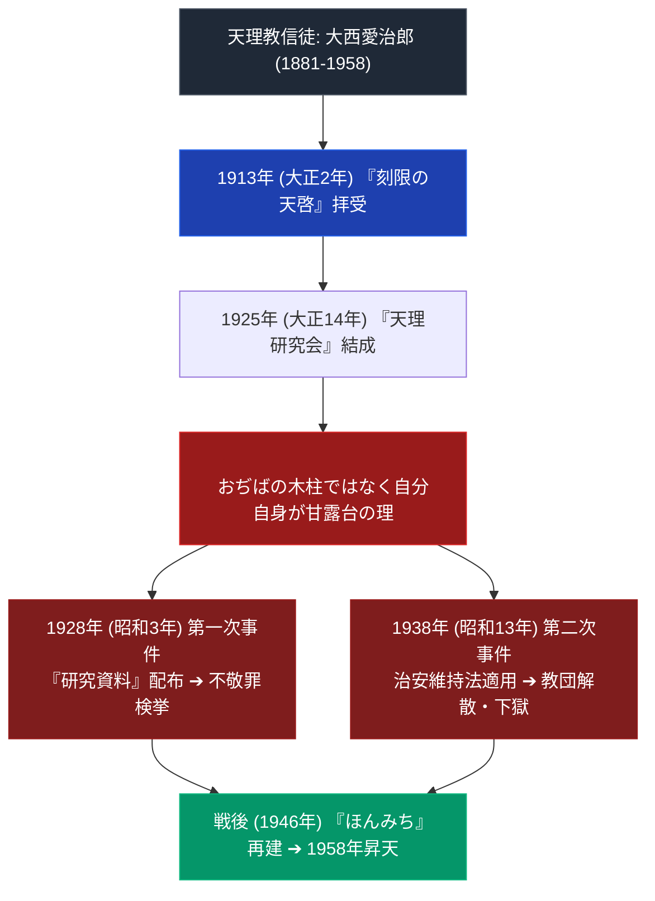

# 大西愛治郎 人物専門構造分析ノート

> [!summary] 要旨
> 本稿は、ほんみち（旧：天理研究会／天理本道）の創始者であり、自らを親神の理を体現する「人間甘露台（第三のやしろ）」と宣言して大日本帝国政府・特高警察と正面衝突した宗教家・[[大西愛治郎]]（1881〜1958）の生涯、天啓拝受の過程、不敬罪・治安維持法裁判の法理、および教理的思想（「泥海初め」「世立て世直し」）を解剖した専門人物ノートである。

---

## 1. 命題の構造（通説・正統本部 vs 本人・分派の自説）

正統本部（天理教）は天啓を教祖中山みき・本席飯降伊蔵で完結したものとするのに対し、大西愛治郎は自らを「甘露台人の理」を持つ新たな天啓者と位置づけ、国家・天皇批判を含む警告文書の配布によって弾圧を受けた。この対立構造が本人の生涯と教理を貫く軸である。

---

## 2. 基本情報

| 項目 | 内容 |
|:--- |:--- |
| **氏名** | 大西愛治郎（おおにし あいじろう / 旧姓: 岸岡） |
| **生没年** | 1881年（明治14年）8月26日（旧閏7月3日） - 1958年（昭和33年）11月29日 |
| **出身地** | 奈良県宇陀郡宇太村（現・奈良県宇陀市） |
| **所属・立場** | [[ほんみち]] 創始者・教祖 |
| **主要な文書** | 『研究資料』（1928年の配布文書）、『書信』（1938年、全7信）等の啓示・警告文書 |
| **主要拠点** | 大阪府高石市羽衣3丁目1-72（ほんみち本部。RIRC教団データベースで確認） |
| **継承** | 孫・大西泰彦がほんみちの次代（現教主） |

---

## 3. 創始者と天啓・社伝

- **入信の経緯**: 1899年（明治32年）頃、奈良師範学校在学中、病に伏した母キサの看病の折の祈祷体験を機に、天理教奈良教会の信徒となった（入信の経緯は教団側の伝承を含む。RIRC教団沿革は「19歳の時、母君の大病より天理教に入信」とする）。
- **天啓の自覚（本人の主張）**: 1913年（大正2年）、神掛かりし、自らを生き神「甘露台」であり中山みきに続く天啓者（「甘露台人の理」）と悟ったと主張。これを天理教本部に訴えると異端と看做され、天理教教師を剥奪された（Wikipediaによる）。
- 天啓体験そのものは教団側の伝承・本人の主張であり、史実として検証できる性質のものではない。本文では主張として層を明示する。

---

## 4. 沿革・歴史変遷

| 年代・年月日 | 年齢 | 史実事件・著作・天啓内容 | 歴史的意義・裁判記録 |
|:--- |:--- |:--- |:--- |
| **1881年 (明治14年) 8月26日** | 0歳 | 奈良県宇陀郡宇太村（現・宇陀市）の農家、岸岡吉次郎とキサの三男として誕生 | 出生（旧姓は岸岡） |
| **1899年 (明治32年) 頃** | 18〜19歳 | 奈良師範学校に入学。在学中、病に伏した母キサの看病の折の祈祷体験を機に、天理教奈良教会の信徒となる（入信の経緯は教団側の伝承を含む。RIRC教団沿革は「19歳の時、母君の大病より天理教に入信」とする） | 天理教信徒としての出発 |
| **明治末〜大正期** | - | 奈良師範学校を中退。群馬県碓氷郡安中町で単独布教、大西トヲと結婚し大西姓を名乗る。山口県の萩・山口・福賀の分教会を再興 | 天理教教師としての布教活動 |
| **1913年 (大正2年)** | 32歳 | 神掛かりし、自らを生き神「甘露台」であり中山みきに続く天啓者（「甘露台人の理」）と悟ったと主張。これを天理教本部に訴えると異端と看做され、天理教教師を剥奪された（Wikipediaによる） | 天啓自覚（要検証：本人の主張）／本部との対立の開始 |
| **1925年 (大正14年)** | 44歳 | 天理教を追放され、同調する天理教信者と共に「天理研究会」を発足 | 正統本部との断絶／分派の正式発足 |
| **1928年 (昭和3年)** | 47歳 | 大戦と国家滅亡を予言警告し天皇の神格を否定する『研究資料』を配布させ、大西を筆頭に500人が不敬罪で検挙・起訴 | **第一次天理研究会（ほんみち）不敬事件** |
| **1928年〜1930年** | 47〜49歳 | 下級審では懲役刑を言い渡されたが、精神に異常をきたした心神喪失者として大審院が無罪判決を言い渡した（1930年） | 精神鑑定による無罪 |
| **1936年 (昭和11年)** | - | 「天理本道」と改称 | 名称変更 |
| **1938年 (昭和13年)** | 57歳 | 『書信』全7信を配布させ、治安維持法違反・不敬罪違反で400人が検挙。大西は無期懲役、教団に結社禁止命令 | **第二次天理研究会（ほんみち）不敬事件** |
| **1945年 (昭和20年)** | 64歳 | 第二次世界大戦の敗戦により釈放・免訴 | 終戦による釈放 |
| **1946年 (昭和21年)** | 65歳 | 大阪府高石市で教団を再建 | 教団再建 |
| **1950年 (昭和25年)** | 69歳 | 教団名を「ほんみち」と改める | 現教団名への改称 |
| **1958年 (昭和33年) 11月29日** | 77歳 | 大阪府高石市羽衣で死去 | 孫・大西泰彦がほんみちの次代（現教主）。大西玉は1961年に天理みろく会を発足させ、1962年に「ほんぶしん」として分離独立 |

---

## 5. 教理・儀礼・神観の深層解剖

### 5-1. 人間甘露台説（親神の理の体現）
- **理念**: 天理教では甘露台は天理市の教団中心部にある物理的な台とされるが、愛治郎は「天理市にあるのは土地の甘露台であり、大西自身が『人の甘露台』である」と主張した（「**甘露台人の理**」）。

### 5-2. 『研究資料』と国家・天皇批判
- **宣示内容**: 1928年（昭和3年）配布の『研究資料』により、大戦と国家滅亡の危機を予言警告し、天皇の神格を否定する内容を主張したとされる。具体的な文言・逐語引用は要検証（Vault内に出典不明の抜粋史料が存在したため今回削除）。

---

## 6. 宗教学的・歴史社会学的意義

- 大西愛治郎の事例は、天理教系分派における「天啓者待望論」（本席没後に新たな天啓者の出現を待望する構造）が、具体的な天啓者自承と教団分離に結実した代表例として位置づけられる。
- 二度の不敬罪・治安維持法事件は、戦前の天皇制と民衆宗教の対決の事例として、村上重良『ほんみち不敬事件　天皇制と対決した民衆宗教』（10節）等の研究対象となってきた。

---

## 7. 拠点・現地情報

- **ほんみち本部**: 大阪府高石市羽衣3丁目1-72（RIRC教団データベースで確認）。
- **出生地**: 奈良県宇陀市（旧・宇陀郡宇太村）。

---

## 8. 関連教団・関連人物・関連概念

- [[ほんみち]]
- [[ほんぶしん]]
- [[大西玉]]
- [[中山みき]]
- [[天理教]]
- [[甘露台]]

---

## 9. 史料・一次資料 (convMD)

> [!note] 引用史料について
> 「泥海初め」「神誡」の逐語引用は出典URL・書誌情報が確認できておらず、本ノートでは参照していない。具体的な引用が必要な場合は一次資料での再確認を要する。

本照合（2026-11-15）でエビデンスとして保存した資料（`content/資料/` 配下）：

- [[src_大西愛治郎_Wikipedia]] — Wikipedia「大西愛治郎」（生没年・年譜の照合に使用）
- [[src_大西玉_Wikipedia]] — Wikipedia「大西玉」（玉の分離独立の経緯の確認に使用）
- [[src_ほんみち_RIRC]] — 宗教情報リサーチセンター（RIRC）教団データベース「ほんみち (o193)」（本部所在地・教団沿革・刊行物リストの確認に使用）
- [[src_大西愛治郎_コトバンク]] — コトバンク「大西愛治郎」（『20世紀日本人名事典』・『デジタル版 日本人名大辞典+Plus』。生没年・経歴の確認に使用）

---

## 10. 参考文献・学術論文

- Wikipedia「大西愛治郎」（生没年・出身地・経歴の確認に使用）
- 宗教情報リサーチセンター（RIRC）教団データベース「ほんみち (o193)」（本部所在地・教団沿革の確認に使用）
- コトバンク「大西愛治郎」（日外アソシエーツ『20世紀日本人名事典』・講談社『デジタル版 日本人名大辞典+Plus』。生没年・経歴の確認に使用）
- ほんみち教義部編『ほんみち概観』（ほんみち教義部、1972年。NDLサーチ書誌で確認。1980年版については留保参照）
- 村上重良「ほんみち」『日本宗教事典』（講談社学術文庫、1988年）
- 村上重良『ほんみち不敬事件　天皇制と対決した民衆宗教』（講談社、1974年）
- 井上順孝ほか編「大西愛治郎」『新宗教教団・人物事典』（弘文社、1996年）
- 松本清張「天理研究会事件」『昭和史発掘４』（文芸春秋、1966年）

---

## 11. 関連ノート (Vault内)

- [[ほんみち]]
- [[ほんぶしん]]
- [[大西玉]]
- [[中山みき]]
- [[_分派・異端研究ポータル]]

---

## 12. 留保（中立的併記・未確定要素）

> [!warning] 留保事項
> - 生年月日（1881年8月26日、旧閏7月3日）・出身地（奈良県宇陀郡宇太村）・没年月日（1958年11月29日、大阪府高石市羽衣で死去）は、Wikipedia「大西愛治郎」とコトバンク収録の人名事典2種（『20世紀日本人名事典』『デジタル版 日本人名大辞典+Plus』）で一致を確認した。
> - 年譜の骨格（1913年の甘露台受念と教師剥奪、1925年の追放と天理研究会発足、1928年の『研究資料』配布・第一次事件・大審院無罪（1930年）、1936年の天理本道改称、1938年の『書信』配布・第二次事件・無期懲役、1945年の釈放・免訴、1946年の再建、1950年のほんみち改称）は、Wikipedia「大西愛治郎」「ほんみち」およびRIRC教団データベースの沿革と照合した。
> - 1913年の「甘露台」受念をはじめとする天啓体験は、教団側の伝承・本人の主張であり、史実として検証できる性質のものではない。本文では主張として層を明示した。
> - 『神誡』『泥海初め』等の逐語引用は出典未確認のため、本ノートでは従前通り参照していない。
>
> 未検証として分離した事項：
> 1. 大西玉の続柄表記：本ノートは「次女」とする。パイロット照合時点では関連ノート[[ほんみち]]が「三女」としており不一致だったが、2026-11-15の第1波照合で[[ほんみち]]側も「次女」に訂正され、[[ほんぶしん]]・[[大西玉]]各ノートとも「次女」で一致した。根拠はWikipedia「ほんぶしん」「大西玉」の記述およびWikipedia「大西愛治郎」の子供欄の並び（愛信・愛子・正憲・玉・清子）から次女と読めることによる。ただし事典類での直接確認は取れていないため、留意事項として残す。
> 2. 天理教からの追放年：Wikipediaは1925年（天理研究会発足と同年）とするが、『デジタル版 日本人名大辞典+Plus』は「大正13年（1924年）追放され、翌年天理研究会を設立」としており、資料により1年の揺れがある。本文はWikipediaに従った。
> 3. 『ほんみち概観』の版：NDLサーチ書誌および都県立図書館目録で確認できるのは1972年版（ほんみち教義部編）のみである。RIRCの刊行物リストには1980年版（ほんみち本部）の記載があり、関連ノート[[ほんみち]]は1980年版を引いている。1980年版の実在と版の異同は未検証。
> 4. 第二次事件の判決年：1938年の検挙・起訴と無期懲役の判決言い渡しは確認したが、判決が確定した年（1942年に第1審判決とする二次的紹介がある）は未確認。
> 5. 愛治郎の没後（1958年）から大西泰彦の教主就任までの、ほんみちの代表者・継承の経緯は未確認である。frontmatterの継承者はWikipedia「大西愛治郎」の「次代：大西泰彦」に従った。
> 6. 要旨中の「第三のやしろ」という表現の出典は未確認である。
> 7. frontmatter主要著作に挙げた『岩戸古記』は、今回照合したWikipedia「大西愛治郎」には現れなかった。出典の特定は未了。
>
> 改訂記録（2026-11-15・パイロット照合）：
> - 年譜の「1923年（大正12年）に天理教教師資格を剥奪され追放される」とする行を削除した。教師剥奪は1913年の本部への訴えの際（Wikipedia）、追放は1925年であり、1923年の裏付けは確認できなかったため、1913年行・1925年行へ振り分けた。
> - 年譜の1881年行に混入していた入信の経緯（母の病を機とする入信）を、1899年頃の行として分離した。入信は出生時の出来事ではなく、奈良師範学校在学中の出来事である。
> - 第1節の図で第一次事件の配布物を『神誡』『泥海初め』としていた点を『研究資料』に訂正した（第3-2節およびWikipediaと整合させた）。
> - 「群馬県安中町」を「群馬県碓氷郡安中町」に、「精神異常者として大審院で無罪」を「心神喪失者として大審院が無罪判決（1930年）」に、それぞれ出典の表記へ寄せて訂正した。
> - frontmatter：主要拠点の番地（高石市羽衣3丁目1-72）をRIRCで確認し「要確認」を解除した。継承者を「大西玉 → 大西泰彦」から「大西泰彦（ほんみちの次代）」に訂正した（大西玉はほんみちの継承者ではなく、1962年にほんぶしんを開いた）。主要著作を配布文書の実態に合わせて書き換え、出典URLにRIRC・コトバンクを追加し、検証日を2026-11-15に更新した。
> - evidence_typeを `primary_source_based` から `secondary_source_based` へ正規化し、confidenceを `5` から `4` へ見直した。理由：本ノートの裏付けはWikipedia・人名事典・RIRC等の二次資料の相互照合によるもので、判決記録・教団原典等の一次資料の直接照合は行っていないためである。旧版の「Wikipedia一次資料で裏付け済み」との表現は誤りのため改めた。
> - 本ノートの evidence_type は `"secondary_source_based"`、confidence は `4`。
>
> 改訂記録（2026-11-15・全件照合）：
> - パイロット照合済みの内容を宗教版12セクションへ再編した（旧構成：思想と史実の構造／年譜／教理思想解剖／史料／参考文献／留保の6節 → 12節）。内容の削除は行っていない。
> - §9の史料参照を、パイロット時に `src_` 接頭辞へ改名済みの実在ファイルへの wikilink（[[src_大西愛治郎_Wikipedia]]等）に付け替えた（旧稿は改名前のファイル名を列挙していた）。
> - 留保の未検証事項1（大西玉の続柄）を更新した：[[ほんみち]]側の「三女」表記は第1波照合で「次女」に訂正済みであり、陳腐化した不一致の記述を、解決済み・根拠明示の形に改めた。
> - 未検証事項7（『岩戸古記』の出典未特定）を追加した。

---

*※本稿は[[_分派・異端研究ポータル]]のほんみち創始者専門人物ノートである。*
