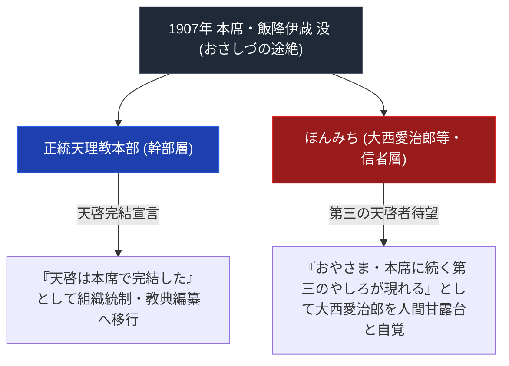

# おさしづ

> [!summary] 要旨
> 『おさしづ』は、教祖・[[中山みき]]没後、本席・[[飯降伊蔵]]の口を通して下された親神の指図を、側にいた書取人が速記・筆録したものを編集して成立した天理教の原典（三原典の一つ、通称「原典（三）」）である。対象期間は1887年（明治20年）から1907年（明治40年）までの20年間で、刻限のお言葉と、個人の身上・事情に対する「伺いさしづ」からなる。現行の公刊本は全7巻（改修版）である。本稿では書誌的事実をWikipedia「天理教」および[[飯降伊蔵]]ノート（第6波照合済み）と突き合わせた上で、本部側の「天啓完結」的な整理と「第三のやしろ待望論」という対立の枠組み（本稿の解釈的整理）については未検証として分離する。

---

## 1. 命題の構造（本席没後の『天啓完結』vs『第三のやしろ待望論』）

> [!note] 本節の対立軸（「天啓完結説」「第三のやしろ待望論」）は本稿の解釈的整理であり、呼称・因果関係の逐語的な典拠確認は未実施である（§12参照）。

---

## 2. 基本情報

| 項目 | 内容 |
| :--- | :--- |
| **書名** | 『おさしづ』 |
| **口述者** | 本席・[[飯降伊蔵]]（教祖によって神意の取次ぎを認められていた） |
| **成立方法** | 飯降の口を通しての神の指図を、側にいた書取人が速記したものを編集して成立（そのため同音異義語の問題がある。Wikipedia「天理教」） |
| **期間** | 1887年（明治20年）〜1907年（明治40年）の20年間 |
| **内容** | 刻限のお言葉（世界と道の事情に対するもの）および個人の身上・事情に対する伺いさしづの筆録。当時筆録されたものが現存する |
| **位置づけ** | 天理教の三原典の一つ。通称「原典（三）」 |
| **現行公刊本** | 全7巻（改修版。「7巻本」とも呼ばれる） |

---

## 3. 起源と成立の経緯

- 教祖・中山みき（第一のやしろ）から飯降伊蔵（第二のやしろ・本席）へと天啓の継承があったという構造自体は、天理教の一般的教理説明として問題ない（[[飯降伊蔵]]ノート参照）。
- 『おさしづ』の個別の神示内容と教団史上の解釈については、原典の直接照合は未実施である（[[飯降伊蔵]]ノートの留保とも一致）。本稿では位置づけの記述にとどめる。

---

## 4. 変遷・歴史（刊行史と戦時中の回収）

Wikipedia「天理教」による刊行史は次の通りである。

- 明治期の筆録が現存し、当初は「33冊本」が使用されていた。
- **1936年（昭和11年）**：教祖50年祭と立教百年祭を記念して刊行された「8冊本」が使用された。
- 戦時体制下の「革新」（1938年）に際し、『おふでさき』と『おさしづ』は使用禁止・各教会から回収され、引用も自粛された。
- **1963年（昭和38年）10月〜翌年4月**：教祖80年祭の記念出版として改修版が公刊された（その冊数から「7巻本」と呼ばれる）。
- **1966年（昭和41年）1月**：教祖80年祭にあわせて『おさしづ』全7巻が新たに公刊され、全教会に配布された（同記事の年表）。

---

## 5. 内容・様式の深層解剖

- 日常生活における現実的な心構えや具体的な解決方法、指導の弁を記したものとされる（Wikipedia「天理教」）。
- 口述の速記・編集という成立方法のため、同音異義語の判別というテキスト上の問題を伴う（Wikipedia「天理教」）。
- ほんみち側では『おさしづ』は「御指図」とも称される（[[ほんみち]]ノートの比較表による）。

---

## 6. 宗教学的・歴史社会学的意義

- 『おさしづ』は、教祖没後に天啓が本席を通じて継続したことを示す原典であり、「天啓の継承」をめぐる本部と分派の解釈対立（§1）の焦点となる。
- ただし「信者層が第三の天啓者を期待した」「ほんみちがそれを根拠に自らを正当化した」という因果的説明は、本稿の解釈であり一次資料・先行研究での逐語的裏付けは未確認である（§12）。大西愛治郎とほんみちの主張内容の詳細（『おさしづ』の具体的にどの記述を根拠としたか）も要検証である。

---

## 7. 拠点・現地情報

- 明治期の筆録原稿は現存する（Wikipedia「天理教」。保管場所の詳細は同記事に明示なし）。
- 現行の全7巻本は天理教教会本部から公刊され、全教会に配布された（1966年）。

---

## 8. 関連教団・関連人物・関連概念

- [[飯降伊蔵]]
- [[中山みき]]
- [[大西愛治郎]]
- [[ほんみち]]
- [[おふでさき]]
- [[みかぐらうた]]

---

## 9. 史料・一次資料 (convMD)

- [[src_天理教_Wikipedia]]（Wikipedia「天理教」。『おさしづ』の成立・刊行史・回収の確認に使用）
- [[src_飯降伊蔵_Wikipedia]]（[[飯降伊蔵]]ノートの照合で保存）
- なお、Wikipediaに「おさしづ」の単独記事はなく、「天理教」記事へリダイレクトされる（2026-11-15にconvMDで取得を試みて確認）。本稿の出典URLもそれに合わせて是正した

---

## 10. 参考文献・学術論文

- 『おさしづ』（天理教教会本部、現行・全7巻改修版）
- 弓山達也『天啓のゆくえ—宗教が分派するとき』

---

## 11. 関連ノート (Vault内)

- [[おふでさき]]
- [[みかぐらうた]]
- [[天理教の分裂の系譜]]
- [[_分派・異端研究ポータル]]

---

## 12. 留保（中立的併記・未確定要素）

> [!warning] 留保事項
> - **訂正（構成表記）**: 旧稿の基本情報は「全7巻・明治篇・大正篇・明治特別篇等」としていたが、「明治篇・大正篇・明治特別篇」という篇名構成は今回の照合資料（Wikipedia「天理教」）では確認できなかった。確認できたのは、現行公刊本が改修版の全7巻（7巻本）であること、旧版に33冊本・8冊本（1936年）があったことのみであり、篇名構成は**未検証**として分離する。
> - **未検証**: 「天啓完結説」「第三のやしろ待望論」という対立軸の呼称・大西愛治郎の具体的論拠は未検証のため、確定的事実としてではなく解釈的整理として記述している（[[飯降伊蔵]]ノートでも『おさしづ』原典の直接照合は未実施とされており、本稿の扱いと一致する）。
> - **是正（出典URL）**: 旧稿の出典URLは Wikipedia「飯降伊蔵」であったが、『おさしづ』の書誌的事実の典拠は Wikipedia「天理教」であるため是正した。
> - **是正（evidence_type / confidence）**: 旧稿は frontmatter が confidence `5`、留保内では `3` と不整合だった。実態はWikipedia等の二次資料に基づく照合であるため、`secondary_source_based` / `3` に統一・是正した。
> - **改訂記録（2026-11-15・全件照合）**: 12セクションへの構造正規化、刊行史（33冊本→8冊本→改修版7巻本）の確定、上記の訂正・分離を実施。バックアップは監査フォルダに保存済み。

---

*※本稿は[[_分派・異端研究ポータル]]の原典分析ノートである。*
