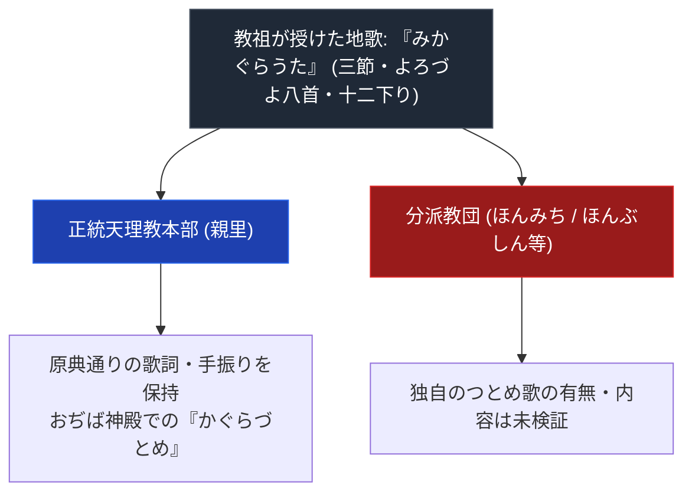

# みかぐらうた

> [!summary] 要旨
> 『みかぐらうた』（御神楽歌）は、天理教の原典（三原典の一つ）であり、おつとめ（かぐらづとめ・てをどり）の地歌である。教祖・[[中山みき]]が1866年（慶応2年）から信者に教え始め、十二下り（1867年）、よろづよ八首・第二節（1870年）、第三節（1875年）の順に成立した。教祖の筆で書かれたものとされる。本稿では成立史と歌詞をWikipedia「みかぐらうた」で照合した上で、分派側の唱歌改変に関する旧稿の主張は裏付けが取れなかったため未検証として分離する。

---

## 1. 命題の構造（正統本部の『みかぐらうた』 vs 分派の独自唱歌）

> [!note] 分派側の「歌詞改変」「独自楽器の導入」等の具体的主張は、[[ほんみち]]・[[ほんぶしん]]両ノートを含む今回の照合範囲では裏付けが取れなかった。本節の対比は本稿の解釈的整理として留め、分派側の列は未検証である（§12参照）。

| 項目 | 正統天理教本部 | ほんみち・ほんぶしん等の分派 |
| :--- | :--- | :--- |
| **地歌** | かぐらづとめの三節・よろづよ八首・十二下り（原典通り） | 独自改変の有無は未検証 |
| **甘露台の理** | おぢば中央の甘露台を中心とするつとめ | 各教団の教理による（個別ノート参照） |

---

## 2. 基本情報

| 項目 | 内容 |
| :--- | :--- |
| **聖典名** | 『みかぐらうた』（御神楽歌） |
| **性質** | 天理教の原典の一つ。おつとめ（かぐらづとめ・てをどり）の地歌。一般には「よろづたすけのつとめ」といわれる地歌を指す |
| **著者・授言者** | [[中山みき]]（教祖の筆で書かれたものとされる） |
| **成立** | 1866年（慶応2年）に教え始め。各部の成立年は§3参照 |
| **構成** | かぐらづとめの地歌三節（第一節〜第三節）、よろづよ八首、十二下り（第一下り〜第十二下り） |
| **儀礼の現場** | 天理教教会本部・神殿（奈良県天理市）ほか各教会 |

---

## 3. 起源と成立の経緯

Wikipedia「みかぐらうた」による成立の経緯は次の通りである。

- **1866年（慶応2年）**：教祖・中山みきが、つとめの地歌であるみかぐらづとめを信仰者に教え始めた。同年秋、第一節「あしきをはらひ たすけたまへ てんりわうのみこと」が授けられた。
- **1867年（慶応3年）正月〜8月**：「十二下り」が教えられ成立した。
- **1870年（明治3年）**：第二節「ちよいとはなし」と「よろづよ八首」が授けられた。
- **1875年（明治8年）**：第三節「あしきはらひ たすけたまへ いちれつすます かんろだい」が授けられた。

なお同記事の脚注は、これらの記述の典拠として『稿本天理教教祖伝』95ページを挙げている。

---

## 4. 変遷・歴史

> [!warning] 戦時中の改変
> 戦時体制下の「革新」に際し、『みかぐらうた』から「よろづよ八首」「三下り目」「五下り目」を削除した『新修御神楽歌』が刊行された（Wikipedia「天理教」）。

- 教祖存命中は口伝と筆写によって伝えられ、おつとめの地歌として定着した。
- 戦後、削除部分を含む原典の形に戻された経緯の詳細は、本稿の照合資料では未確認である。

---

## 5. 内容・様式の深層解剖

### 5-1. かぐらづとめの地歌（三節）

Wikipedia「みかぐらうた」に確認できる歌詞は次の通りである（表記は同記事による）。

- 第一節：**「あしきをはらひ たすけたまへ てんりわうのみこと」**（1866年秋）
- 第二節：**「ちよいとはなし」**（1870年。全文は未収録）
- 第三節：**「あしきはらひ たすけたまへ いちれつすます かんろだい」**（1875年）

### 5-2. 様式

- 「つとめ」では鳴物の音律に合わせて一定の手振りや足の動きなどで「おてふり」を行い、この地歌を歌うことに基本的な信仰の心得が集約的にうたいこまれていると教えられている（Wikipedia「みかぐらうた」）。
- 教祖の言葉として「これは理の歌や。理に合わせて踊るのやで。ただ踊るのではない。理を振るのや。」が伝えられる（同記事）。
- 旋律・言語的特徴（わらべ歌・雅楽調との関係等）の詳細な音楽学的分析は本稿では未検証。

---

## 6. 宗教学的・歴史社会学的意義

- 『みかぐらうた』は『おふでさき』『おさしづ』とともに三原典を構成し、信仰者にとって最も身近な教理とされる（Wikipedia「みかぐらうた」）。
- 歌と手振りによって教理を身体化する形式は、天理教の儀礼研究における基本対象である。

---

## 7. 拠点・現地情報

- 天理教教会本部・神殿（奈良県天理市）で朝夕のおつとめ・月次祭のかぐらづとめが行われる。
- 原文テキストはウィキソース「みかぐらうた」で公開されている（Wikipedia「みかぐらうた」の外部リンク）。

---

## 8. 関連教団・関連人物・関連概念

- [[中山みき]]
- [[おふでさき]]
- [[おさしづ]]
- [[ほんみち]]
- [[ほんぶしん]]
- [[甘露台]]

---

## 9. 史料・一次資料 (convMD)

- [[src_みかぐらうた_Wikipedia]]（Wikipedia「みかぐらうた」。成立史・歌詞の確認に使用）
- [[src_天理教_Wikipedia]]（Wikipedia「天理教」。戦時中の『新修御神楽歌』の確認に使用）
- 旧稿が §5 で参照していた `src_ofudesaki_select`・`src_osashizu_select` は、資料フォルダに実在しない**幽霊典拠**であったため参照を削除した（内容は上記の実在ファイルで代替）。

---

## 10. 参考文献・学術論文

- 『稿本天理教教祖伝』（天理教教会本部、1956年）。Wikipedia「みかぐらうた」の脚注が成立史の典拠として95ページを挙げる
- 『改訂 天理教事典』（天理教道友社、1997年、ISBN 4-8073-0412-7）。Wikipedia「みかぐらうた」の参考文献

---

## 11. 関連ノート (Vault内)

- [[おふでさき]]
- [[おさしづ]]
- [[稿本天理教教祖伝]]
- [[奈良以外の甘露台と異端甘露台一覧]]
- [[_分派・異端研究ポータル]]

---

## 12. 留保（中立的併記・未確定要素）

> [!warning] 留保事項
> - **訂正（成立時期）**: 旧稿は「1866〜1882年にかけて作詞・作曲」としていたが、Wikipedia「みかぐらうた」によれば各部の成立は1866年（教え始め）〜1875年（第三節）であり、1882年までとする根拠は確認できなかった。本文を成立年ごとに訂正した。
> - **訂正（歌詞）**: 旧稿§3の引用歌詞（第一歌「あしきをはらふて たすけたまえ 天理王命」、第三歌「あしきをはらふて たすけせかいひろめよ」「いちろついたる かんろだい」）は、Wikipedia「みかぐらうた」の表記（第一節「あしきをはらひ たすけたまへ てんりわうのみこと」、第三節「あしきはらひ たすけたまへ いちれつすます かんろだい」）と食い違う誤記・改変と判断し、出典表記に訂正した。
> - **未検証**: 分派（ほんみち・ほんぶしん）における歌詞改変・独自楽器の導入という旧稿§1の主張は、[[ほんみち]]・[[ほんぶしん]]両ノートを含む今回の照合範囲で裏付けが取れなかったため、未検証として分離した。旧稿の frontmatter「関連拠点: 奈良県天理市三島町」も出典未確認のため所在地の細部は分離した。
> - **訂正（幽霊典拠）**: 旧稿の `src_ofudesaki_select`・`src_osashizu_select` は実在しないファイルへの参照だった（cross-note-flags でも参照切れとして記録済み）。実在ファイルへ付け替えた。
> - **是正（出典URL・evidence_type / confidence）**: 旧稿の出典URLは天理教公式サイトの動画ページであり、本稿の事実確認の典拠ではなかったため Wikipedia「みかぐらうた」に是正した。旧稿は frontmatter が `mixed_secondary_unverified` / confidence `5` で、留保セクション自体が存在しなかった。実態に合わせ `secondary_source_based` / `3` とした。
> - **改訂記録（2026-11-15・全件照合）**: 12セクションへの構造正規化（留保セクションの新設を含む）、成立史・歌詞の訂正、幽霊典拠の付け替えを実施。バックアップは監査フォルダに保存済み。

---

*※本稿は[[_分派・異端研究ポータル]]の原典・おつとめ歌分析ノートである。*
