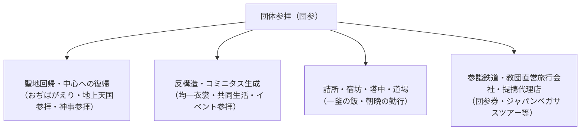

# 団体参拝 専門構造分析ノート

> [!warning] 出典の性質
> 本ノートは概念・ハブ型の横断ノートであり、旧稿（増補改訂第6版）は出典の多くが教団・企業の公式サイトと書誌情報のみの文献リストに依拠し、個別記述の出典対応が取れていなかった。今回の全件照合（2026-11-15）では、ジャパンペガサスツアーの登録情報・天理教の団参券・金光教の金光臨については公式サイト・Wikipediaで確認できた一方、大本の大祭名や日蓮正宗の登山列車等の詳細は照合済みの各教団ノートで確認できず、未検証として分離した（12節参照）。一覧・ハブ型ノートの照合方針として、検証日の明示と未検証の分離を優先している。

> [!summary] 要旨
> **団体参拝**（だんたいさんぱい、略称：**団参**〈だんさん〉）とは、宗教教団や伝統寺社において、講・支部・教会などの信徒組織が集団を形成し、本山・総本山・中心聖地へ参詣する集団的巡礼実践。近世の伊勢講・富士講等の民俗的参詣を歴史的先条とし、明治以降の「参詣鉄道」の発達や昭和のモータリゼーション（貸切バス）と結合して高度に制度化された。聖地における**「詰所（つめしょ）」「宿坊（しゅくぼう）」「修養道場」**等の集団宿泊施設、[[世界救世教]]の熱海・瑞雲郷や箱根・神仙郷にみられる**美の聖地への集団参拝**、[[大本]]の**二大聖地（綾部・亀岡）巡拝**、さらには[[ワールドメイト]]における**教団関連の政府登録旅行会社（ジャパンペガサスツアー）による手配の内製化**など、世俗の日常から離脱した信徒が集団的連帯（ヴィクター・ターナーの謂う**コミニタス**）と聖性を再充填するための核心的空間・交通手配装置として機能している。

---

## 1. 命題の構造（概念の位置づけ）

団体参拝は単なる「移動手段・ツアー」にとどまらず、宗教・社会・交通・建築・経済・旅行手配インフラが複雑に交錯する複合的現象である。

本ノートの分析枠組み（3大構造モデル、5節）は旧稿の整理によるものであり、学術文献で確立した分類ではない点に留意されたい。

---

## 2. 基本情報

| 項目 | 内容 |
|:--- |:--- |
| **呼称** | 団体参拝（団参）。教団により「おぢばがえり」（天理教）、「登山」（日蓮正宗）等の固有呼称がある |
| **定義** | 信徒組織が集団を形成し、本山・総本山・中心聖地へ参詣する集団的巡礼実践 |
| **前身** | 近世の伊勢講・富士講等の講運動 |
| **制度化の契機** | 明治・大正期の参詣鉄道の発達、昭和のモータリゼーション（貸切バス） |
| **付随インフラ** | 詰所・宿坊・塔中・修養道場等の集団宿泊施設、団参券・団体臨時列車、教団関連旅行会社 |

---

## 3. 起源と成立の経緯

- 近世には伊勢講・富士講等の「講」を単位とする集団参詣が民俗的実践として広く行われていた（一般的歴史理解。具体的な典拠は本ノートでは未取得）。
- 明治以降、鉄道網の敷設により聖地への大規模な集団移動が可能となり、「参詣鉄道」と呼ばれる路線・臨時列車の運行と結びついて団体参拝は制度化されていった。
- 昭和のモータリゼーションにより貸切バスが加わり、地方支部単位の直行輸送が一般化した。

---

## 4. 沿革・歴史変遷

- 戦前：大正〜昭和初期、国鉄各線で参拝客用の団体専用列車・臨時列車が運行された（個別教団の事例の詳細は各教団ノート参照。大本に関する旧稿の具体的記述は今回未検証として分離、5節・12節参照）。
- 戦後〜現代：昭和40年代以降のモータリゼーションおよび高速道路網の整備に伴い、地方支部ごとの直行貸切バス（団参バス）が主力の集団輸送インフラとなった。
- 現代：鉄道の団体割引制度（団参券等）や教団関連の旅行会社による手配内製化など、手配形態は多様化している。

---

## 5. 内容の深層解剖

### 5-1. 宗教教団と旅行手配（旅行会社）の3大構造モデル比較

現代日本の宗教界における団体参拝・巡礼の交通・旅行手配は、旧稿の整理では大きく以下の3つの構造モデルに分類される。

| モデルタイプ | 概要・手配メカニズム | 代表的な教団・事例 | 特徴と経営・神学的メリット |
|:--- |:--- |:--- |:--- |
| **モデルA: 教祖・関連事業体 直営第1種旅行会社型** | 宗教法人（あるいは教祖・関連親会社）が自ら政府登録（観光庁長官登録）の**第1種旅行業者**を設立・所有し、手配を完全に内製化するモデル。 | **[[ワールドメイト]]** （ジャパンペガサスツアー株式会社：観光庁長官登録旅行業第626号、代表取締役社長：半田晴久） | 手配手数料のグループ内循環、大規模バスツアー・海外神業の柔軟手配、国際イベント・海外VIP（元首相等）招聘手配の機動性向上。**日本の新宗教において極めて異例な形態。** |
| **モデルB: 大手旅行会社 専用窓口・特約提携型** | 直営旅行会社は持たず、JTBや日本旅行、近鉄などの大手鉄道・旅行会社と直接提携し、教団専用窓口や専用割引切符を設けるモデル。 | **[[天理教]]**（近鉄「団参券」制度。JTB天理営業所の存在は未検証） **[[創価学会]]**（日本旅行等による集団登山列車・研修ツアー手配の歴史。未検証） **[[金光教]]**（JR金光駅発着の団体専用列車「金光臨」） | 自前で旅行業リスク・営業保証金を抱えず、大手インフラのダイヤ・輸送力をフル活用できる信頼性。 |
| **モデルC: 巡礼・参拝専門 独立系旅行会社協働型** | 宗教法人とは独立した「寺社参拝専門」「四国お遍路専門」「キリスト教聖地巡礼専門」の旅行会社がツアーを企画・運行するモデル。 | **伝統仏教・霊場会**（琴平バス「四国巡拝センター」、鳳友産業「ホウユウツアーズ」、ビーエス観光等） **カトリック・キリスト教**（教友社、サントラベル、ワールドビュウ等） | 先達・牧師・僧侶の同行解説や、特定の宗派・巡礼地に特化した高度な専門性の提供。 |

（モデルCの個別旅行会社の実在・業務内容は今回未検証。）

### 5-2. 主要教団における団体参拝構造と交通インフラ

#### 5-2-1. [[天理教]]（おぢばがえり・親里参拝）
* **特徴**: 日本で最も体系化された団体参拝構造を持つとされる。「帰る」という表現（おぢばがえり）を用い、親里（天理市）への参拝を信仰の根本に置く。
* **鉄道・旅行手配**: 近畿日本鉄道（近鉄）は大祭やこどもおぢばがえりシーズンに臨時列車を運行している。天理教輸送部乗車券うりばでは、運賃区界駅から天理駅へ向かう近鉄（乗入先の阪神電鉄を含む）の団体専用乗車券（概ね25％割引、通称「団参券」）が発売される（Wikipedia「天理教」で確認）。大手旅行会社の**JTB**に「天理営業所」が置かれているという旧稿の記述は、今回確認した資料では裏付けが取れなかった（未検証）。

#### 5-2-2. [[金光教]]（本部参拝・金光臨）
* **特徴**: 岡山県浅口市金光町の本部神殿への参拝。
* **鉄道交通**: JR山陽本線金光駅発着の団体専用列車「金光臨」が祭礼時に運行される（Wikipedia「金光教」で確認）。金光駅に参拝者専用の「団体専用改札（2020年に常設改修）」が設置されていたという旧稿の記述は、今回確認した資料では裏付けが取れなかった（未検証）。

#### 5-2-3. [[大本]]（二大聖地巡拝）
* **二大聖地構造**:
* **京都府綾部市（梅松苑）**: 開教の地、祭祀の中心聖地。
* **京都府亀岡市（天恩郷・旧亀山城跡）**: 出口王仁三郎が開拓した宣教・芸術・教団機構の中心聖地。
* 旧稿が記した大祭名（「節分大祭」「みろく大祭」「瑞恩感謝祭」）、参拝バスの運行形態、戦前の臨時列車やバス停留所名等の詳細は、照合済みの[[大本]]ノートでは確認できなかったため、本稿では未検証として分離し、個別の記述は削除した（12節参照）。

#### 5-2-4. [[ワールドメイト]]（神事参拝・ジャパンペガサスツアー）
* **特徴**: 教祖・深見東州（半田晴久）が代表取締役社長を務める**「ジャパンペガサスツアー株式会社（観光庁長官登録旅行業第626号）」**が移動・参拝バス・航空券の手配を担う。同社は1982年8月23日設立、同年10月2日に観光庁長官登録を受け、所在地は東京都杉並区西荻南2丁目18番9号（ワールドメイト教団本部と同一住所）である（同社公式サイト「会社案内」で確認）。Wikipedia「ワールドメイト」も同社を「会員向けの開運商法旅行」を行う旅行会社として記載している。
* **参拝形態**: 静岡県伊豆の国市の総本山「皇大神御社」参拝（[[ワールドメイト]]ノートで確認）のほか、全国の神社・霊山への「神事参拝バスツアー」が運行されているとされる（個別ツアーの詳細は未検証）。

#### 5-2-5. [[日蓮正宗]]・旧[[創価学会]]（大石寺登山）
* **特徴**: 静岡県富士宮市の総本山大石寺への「登山（参拝）」。
* 旧稿が記した「大石寺登山臨時列車（富士号等）」「日本旅行が集団輸送を担当した」という交通史の詳細は、今回確認した資料では裏付けが取れなかった（未検証）。現在は法華講主導の「登山バス（貸切バス）」中心へ移行したとされる（同上、未検証）。

#### 5-2-6. [[世界救世教]]系（熱海・瑞雲郷／箱根・神仙郷参拝）
* **創始者と聖地**: [[岡田茂吉]]造営の**熱海・瑞雲郷**（MOA美術館）および**箱根・神仙郷**（箱根美術館）への参拝。美と信仰の融合（聖地の存在は[[世界救世教]]ノートで確認）。
* **交通手段**: 全国の教会・支部から直行する「熱海・箱根参拝バス」や東海道新幹線ラインが確立しているとされる（運行実態の詳細は未検証）。[[神慈秀明会]]等も重視。

### 5-3. 主要教団の団体参拝構造比較マトリクス

| 教団名 | 聖地・本山 | 参拝の名称 | 主な交通・手配機関 | 宿泊・滞在施設 | 特記事項・歴史的背景 |
|:--- |:--- |:--- |:--- |:--- |:--- |
| **[[天理教]]** | 奈良県天理市（親里・おぢば） | **おぢばがえり** | 近鉄臨時列車・団参券 | **大教会詰所**（箇所数は未検証） | 団参券（概ね25％割引）はWikipediaで確認。月次祭（26日）・こどもおぢばがえり（7-8月）に参拝が集中する。 |
| **[[金光教]]** | 岡山県浅口市（金光本部） | **金光参拝** | JR「金光臨」 参拝バス | **信徒会館・宿（宿社）**（未検証） | 「金光臨」はWikipediaで確認。団体専用改札の有無は未検証。 |
| **[[大本]]** | 京都府綾部市（梅松苑） 京都府亀岡市（天恩郷） | **本部大祭参拝** | 参拝バス JR山陰本線 | 参拝宿泊施設（名称・詳細は未検証） | 綾部（発祥）と亀岡（宣教）の二大聖地構造は[[大本]]ノートで確認。大祭名・運行形態の詳細は未検証。 |
| **[[ワールドメイト]]** | 静岡県伊豆の国市（皇大神御社） 全国著名神社・霊山 | **神事参拝 / 大神業** | **ジャパンペガサスツアー** （観光庁長官登録第626号） | 伊豆総本部施設・ホテル | 教祖が代表取締役社長を務める登録旅行会社が手配を担う（公式サイト会社案内で確認）。 |
| **[[日蓮正宗]]** | 静岡県富士宮市（大石寺） | **大石寺登山** | 登山バス（貸切） | **塔中（坊・宿坊）** | かつて創価学会員による大規模な登山が行われた。列車輸送の詳細（富士号・日本旅行）は未検証。 |
| **[[世界救世教]]** | 静岡県熱海市（瑞雲郷） 神奈川県箱根町（神仙郷） | **地上天国参拝 / 本部参拝** | 参拝バス 東海道新幹線 | 研修施設等（詳細は未検証） | [[岡田茂吉]]造営の熱海・瑞雲郷（MOA美術館）や箱根・神仙郷（箱根美術館）への参拝。 |

---

## 6. 宗教学的・歴史社会学的意義

- **コミニタス**: ヴィクター・ターナーの巡礼論では、日常の社会構造から離脱した巡礼者の集団に平等で直接的な連帯感（コミニタス）が生じるとされる。団体参拝はこの枠組みで分析されることがある（分析枠組みの紹介であり、本ノート独自の実証ではない）。
- **聖地経済・交通史**: 参詣鉄道や団体割引制度は、宗教実践が地域交通・観光インフラの形成に与えた影響を示す事例として位置づけられる。
- **手配の内製化**: ワールドメイトのように教団関連事業体が第1種旅行業を担う事例は、新宗教の事業展開の研究対象となる。

---

## 7. 拠点・現地情報

主要な聖地・本山は2節・5-3節の表の通り。各聖地の詳細は[[おぢばがえりと親里詰所建築群]]・[[MOA美術館と岡田茂吉ゆかりの美術館群]]等の個別ノートを参照。

---

## 8. 関連教団・関連人物・関連概念

### 関連教団
- [[天理教]]
- [[金光教]]
- [[大本]]
- [[ワールドメイト]]
- [[日蓮正宗]]
- [[創価学会]]
- [[立正佼成会]]
- [[世界救世教]]
- [[神慈秀明会]]
- [[真如苑]]

### 関連人物
- [[岡田茂吉]]
- [[出口王仁三郎]]
- 深見東州（半田晴久）

### 関連概念
- 巡礼 / コミニタス / 聖地 / 詰所 / 宿坊 / 塔中 / ジャパンペガサスツアー / 団参券 / 参詣鉄道 / 天理臨 / 金光臨 / ひのきしん / 作務 / 神人共食 / MOA美術館

---

## 9. 史料・一次資料 (convMD)

- [[src_団体参拝_ジャパンペガサスツアー会社案内]]（同社公式サイト「会社案内」。観光庁長官登録旅行業第626号・1982年10月2日登録・代表取締役社長 半田晴久・設立1982年8月23日を確認、2026-11-15取込）
- [[src_団体参拝_ジャパンペガサスツアー公式]]（同社公式サイト トップページ。「1982年 創業」「観光庁長官登録旅行業 第626号」を確認、2026-11-15取込）
- [[src_天理教_Wikipedia]]（団参券＝団体専用乗車券・概ね25％割引・天理教輸送部乗車券うりば、近鉄の臨時列車運行を確認）
- [[src_金光教_Wikipedia]]（祭礼時に「金光臨」と呼ばれる団体専用列車が金光駅発着で運行されることを確認）
- [[src_ワールドメイト_Wikipedia]]（ジャパンペガサスツアーが会員向け旅行会社であること、皇大神御社が総本山であることを確認）

---

## 10. 参考文献・学術論文

- 弓山達也『現代宗教と交通文化: 移動する聖地』（書誌の実在は今回未確認＝未検証）
- 近畿日本鉄道『近畿日本鉄道100年史』（2010年）（同上、未確認）
- 天理教道庁『天理教事典』（実在は第1波の照合で確認済み）
- 大本本部『大本七十年史』（書誌の実在は今回未確認＝未検証）
- ワールドメイト 公式ウェブサイト (https://www.worldmate.or.jp/)
- ジャパンペガサスツアー株式会社 企業情報 (https://www.jp-tour.com/)

---

## 11. 関連ノート (Vault内)

- [[おぢばがえりと親里詰所建築群]]
- [[MOA美術館と岡田茂吉ゆかりの美術館群]]
- [[天理教]]
- [[金光教]]
- [[大本]]
- [[ワールドメイト]]
- [[日蓮正宗]]
- [[世界救世教]]
- [[_分派・異端研究ポータル]]

---

## 12. 留保（中立的併記・未確定要素）

> [!warning] 留保事項
> - 未検証として分離した旧稿の主張：(1) JTB「天理営業所」の存在。(2) 天理の大教会詰所「約150箇所」という数値。(3) 金光駅の「団体専用改札（2020年に常設改修）」。(4) 大本の「節分大祭」「みろく大祭」「瑞恩感謝祭」という大祭名、参拝バスの運行形態、戦前の臨時列車・バス停留所名等の詳細。(5) 日蓮正宗の大石寺登山臨時列車「富士号」および日本旅行による輸送担当の歴史。(6) 創価学会の集団登山列車・研修ツアー手配の歴史。(7) モデルCの個別旅行会社（琴平バス・鳳友産業・教友社等）の実在・業務内容。(8) 参考文献のうち弓山達也『現代宗教と交通文化』・『近畿日本鉄道100年史』・『大本七十年史』の書誌の実在。
> - 3大構造モデル（モデルA/B/C）は旧稿の分析的整理であり、学術的に確立した分類ではない。
> - 改訂記録（2026-11-15・全件照合）: 旧稿は6セクション構成で留保節自体がなく、evidence_type は `academic_research`、confidence は `5` と過大であった。今回、12セクションへ再編し、留保節を新設した。確認できた事実：ジャパンペガサスツアーの観光庁長官登録旅行業第626号・代表取締役社長 半田晴久・設立1982年（同社公式サイト会社案内）、天理教の団参券（Wikipedia「天理教」）、金光教の金光臨（Wikipedia「金光教」）、ワールドメイト総本山・皇大神御社（照合済み[[ワールドメイト]]ノート）。旧稿の「代表：半田晴久/深見東州」は公式表記に合わせ「代表取締役社長 半田晴久」に統一した。
> - 本ノートの evidence_type は `mixed_secondary_unverified`、confidence は `3`（中核事例の一部は公式資料・Wikipediaで確認できたが、教団別の詳細記述の多くは出典対応が取れておらず未検証のままだため）。

---

*※本稿は[[_分派・異端研究ポータル]]の概念・交通・信仰実践構造分析ノートである。*
