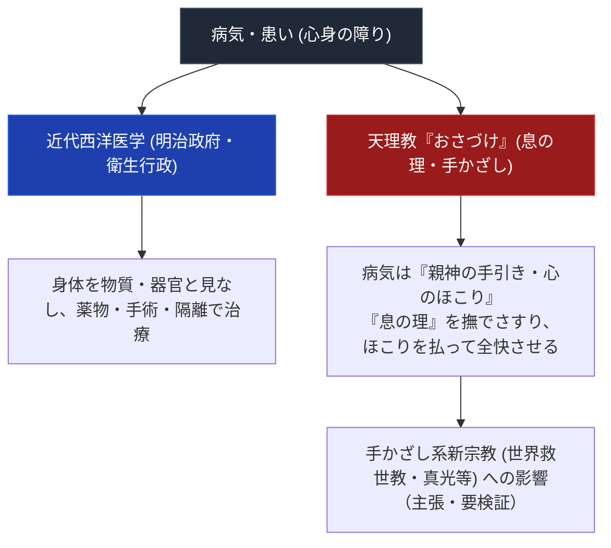

# 天理教のおたすけ・おさづけと近代病気救済史 専門構造分析ノート

> [!summary] 要旨
> 本稿は、天理教の核心救済儀礼「おさづけ（息の理・手かざし・心直し）」の構造、明治〜昭和期における近代西洋医学・衛生行政との緊張（「淫祀邪教」視）、および世界救世教や真光などの「手かざし系新宗教」への史的影響の主張を解剖した専門ノートである。おさづけの制度そのもの（別席・拝受の手続き）の詳細は[[おさづけ]]ノートを参照。

---

## 1. 命題の構造（近代西洋医学 vs 天理教の「心直し・おさづけ」救済）

| 比較軸 | 近代西洋医学 | 天理教のおさづけ | 手かざし系新宗教 (救世教/真光) |
| :--- | :--- | :--- | :--- |
| **病因論** | 細菌・ウイルス・器官不全 | 心のほこり（八つのほこり）・神の手引き | 霊の曇り・憑依・毒素 |
| **治病手段** | 投薬・注射・手術 | 「おさづけの理」を撫でさすり伝授・祈祷 | 手かざし・浄霊・お清め |
| **資格・伝授** | 医師免許（国家資格） | 別席（9回受講）を経て「おさづけ」拝受 | 講習会受講・おみたま着用 |

---

## 2. 基本情報

| 項目 | 内容 |
| :--- | :--- |
| **儀礼名** | おさづけ（おさづけの理）。現行は「てをどりのさづけ（あしきはらひのさづけ）」 |
| **対象** | 病む人に取り次いで身上（心身の不調）回復の守護を願う祈りの手立て |
| **拝受要件** | 教会本部（おぢば）で「別席」を九度（9回）運び、心を洗い立て、たすけ一条を誓って願い出ること（天理教公式サイト） |
| **実施者** | おさづけの理を戴いた信者（「ようぼく」） |
| **本部** | 天理教教会本部（奈良県天理市三島町1番地1） |

---

## 3. 起源と成立の経緯

- 原典『おふでさき』第六号には「これからハいたみなやみもてきものも いきてをどりでみなたすけるで」（106）、「このたすけいまゝでしらぬ事なれど これからさきハためしゝてみよ」（107）とあり、おさづけによるたすけは原典に位置づけられる（天理教公式サイト「さづけ」）。
- 教祖は、おさづけの理が人だすけの道を通るうえでの手だてであることを「路銀（路金）」にたとえて教えたとされる（『稿本天理教教祖伝』第三章、公式サイト引用）。
- 制度としての詳細な成立過程（別席制度の整備等）は本ノートでは未照合であり、[[おさづけ]]ノートおよび原典照合に委ねる。

---

## 4. 沿革・歴史変遷（近代医療行政との衝突）

> [!warning] 本節の取締りの根拠法令等は未確認事項を含む

- **明治政府の弾圧**: 「薬物不使用・手かざし・祈祷で病気を治すと称する行為」への警察取締りがあった（[[明治の教難と教祖牢くぐり]]・[[明治の教難と教派神道独立]]参照。取締り根拠の具体的な布告名・年号は未確認）。
- **後続宗教への流出（主張）**: 天理教の「手かざし・撫でさすり救済」の成功は、大本、世界救世教（岡田茂吉）、崇教真光（岡田光玉）など、近代日本の「手かざし系新宗教」の源流の一つとされることがあるが、個別の伝播経路の実証は本ノートでは未検証（留保参照）。

---

## 5. 内容の深層解剖

### 5-1. 「おさづけ」の儀礼構造と「息の理」
- **拝受要件**: 奈良親里（おぢば）で「別席（べっせき）」を九度（9回）運んだ信者が、「おさづけの理」を拝受する（天理教公式サイトで確認済み）。
- **儀礼動作**: 患者に対し、神名を唱えながら身体を撫でさすり、「息の理」を吹きかけるとされる（手続きの詳細は[[おさづけ]]参照）。ただし息を吹きかける形式（息のさづけ）は、教祖や本席から限られた人物にのみ授けられた歴史的な形式であり、現行のおさづけは次項のてをどりのさづけである（[[おさづけ]]ノートの整理による）。
- **現行の形式**: 現行のおさづけは「てをどりのさづけ（あしきはらひのさづけ）」であり、病む人に取り次いで身上回復の守護を願うものと公式に説明される。

### 5-2. 病因論
- 病気は神の罰ではなく、人間が「親神の守護」を忘れて心に「ほこり」を溜めたことに対する親心の「手引き（メッセージ）」とされる。

---

## 6. 宗教学的・歴史社会学的意義

- おさづけは、薬物を用いない祈祷的救済を制度化（別席による資格付与）した点で、近代日本の宗教的医療の代表例として位置づけられる。
- 国家資格（医師免許）による医療の独占が進む近代化過程で、宗教的治病がどのように規制・適応・存続したかを考察する素材となる。
- 手かざし系新宗教（世界救世教の浄霊、真光の手かざし等）との比較は §1 の表のとおりだが、直接の系譜的影響関係は個別検証を要する。

---

## 7. 拠点・現地情報

- **教会本部（おぢば）**: 奈良県天理市三島町1番地1。別席の受付・別席場の所在等の実務情報は[[おさづけ]]ノート参照。
- 本部所在地の地番は、2015年に三島町271番地から1番地1へ表示変更された（天理教公式サイト「地番表示変更」告知）。

---

## 8. 関連教団・関連人物・関連概念

- [[おさづけ]]（「おさづけ」自体の儀礼構造・別席制度に特化した専門ノート）
- [[浄霊]]（比較対象。世界救世教の類似儀礼）
- [[手かざし]]（より広い歴史的文脈）
- [[おふでさき]]
- [[明治の教難と教祖牢くぐり]]
- [[陽気ぐらしと天理教の社会福祉・医療]]

---

## 9. 史料・一次資料 (convMD)

- [[src_おたすけおさづけ_天理教公式さづけ]] — 天理教公式サイト「さづけ」（convMD取込、2026-11-15）。九度の別席・ようぼく・現行形式（てをどりのさづけ）の典拠
- [[src_天理教_公式地番表示変更]] — 天理教公式サイト「宗教法人天理教および宗教法人天理教教会本部 地番表示変更」（2015年、convMD取込、2026-11-15）。本部所在地（三島町1番地1）の典拠

---

## 10. 参考文献・学術論文

- 天理教公式サイト「さづけ」 https://www.tenrikyo.or.jp/yoboku/oshie/sazuke/
- 天理教公式サイト「別席」 https://www.tenrikyo.or.jp/yoboku/besseki/ （[[おさづけ]]ノートの出典。本ノートでは未取得）

---

## 11. 関連ノート (Vault内)

- [[おさづけ]]
- [[浄霊]]
- [[手かざし]]
- [[おふでさき]]
- [[明治の教難と教祖牢くぐり]]
- [[陽気ぐらしと天理教の社会福祉・医療]]
- [[_分派・異端研究ポータル]]

---

## 12. 留保（中立的併記・未確定要素）

> [!warning] 留保事項
> - 別席9回（九度の別席）・おさづけ拝受の流れは天理教公式サイト「さづけ」で確認済み。
> - 明治期の取締り根拠となった具体的な布告名・年号は未確認。
> - 「手かざし系新宗教への源流」という影響関係の主張は、個別の伝播経路（誰が・いつ・どのように影響を受けたか）の実証が本ノートでは未検証であり、比較表・§4では主張として分離して記した。
> - **改訂記録（2026-11-15・全件照合）**: 宗教版12セクションへ再編（旧稿はセクション番号が1・2・3・5・6と欠落していた）。(1) frontmatter の evidence_type `mixed` は7値外のため、実態（教団公式サイト等の二次資料中心）に合わせて `secondary_source_based` に正規化し、frontmatter（5）と留保（3）で食い違っていた confidence を 3 に統一した。(2) 旧稿の出典URL（天理教公式サイトの2015年「地番表示変更」告知ページ）は、おさづけ・別席の記述内容を裏付けるページではなかったため、公式サイト「さづけ」ページへ付け替え、地番告知は本部所在地の典拠として分離した。(3) 本部所在地の郵便番号は、[[天理教]]ノートの記載（〒632-8501）と旧稿の記載（〒632-8686）が食い違うため、本ノートでは郵便番号を外し、公式告知で確認できる地番（三島町1番地1）のみを記した。
> - **追補（2026-11-15・第7波概念Bの指摘による）**: §5-1の儀礼動作の記述に、息のさづけは歴史的な形式であり現行はてをどりのさづけである旨の区別を明記した（[[おさづけ]]ノート・天理教公式サイト「さづけ」で確認）。
> - 本ノートの evidence_type は `secondary_source_based`、confidence は `3`。

---

*※本稿は[[_分派・異端研究ポータル]]の病気救済・宗教人類学分析ノートである。*
