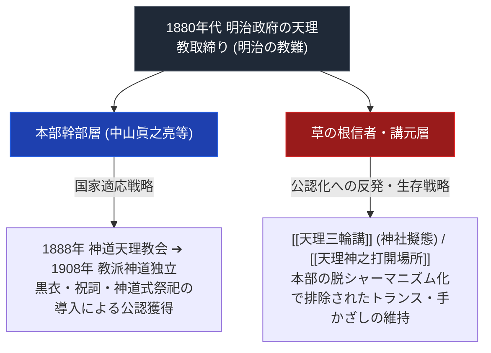

# 明治の教難と教派神道独立

> [!summary] 要旨
> 本稿は、明治政府による天理教取締り（明治の教難）に対し、天理教幹部層が1888年に神道本局傘下の「神道天理教会」の公認を得て、1908年（明治41年）に「教派神道独立」を果たした国家公認プロセスの専門構造分析ノートである。1896年（明治29年）には内務省の秘密訓令第12号による取締り強化もあった。国家適応の代償として原初の熱狂的・呪術的要素が排除され、[[天理三輪講]]や[[天理神之打開場所]]等の分派講社が派生した歴史メカニズムを解剖する。

---

## 1. 命題の構造（国家公認・教派神道化 vs 排除された原初講社）

| 比較考察軸 | 正統本部 (教派神道独立派) | 排除・派生した草の根講社 |
|:--- |:--- |:--- |
| **国家戦略** | 神道十三派の一つとして公認獲得（1908年） | 警察の目を逃れるための独自神社擬態・隠れ講社 |
| **教理・儀礼** | 神道的な祝詞・祭詞の導入（明治〜昭和初期） | 教祖直伝のて踊り・かぐら・即効的手かざしの死守 |
| **歴史的影響** | 現代の巨大教団「天理教」の基礎 | 様々な天理系分派・異端講社の萌芽 |

---

## 2. 基本情報

| 項目 | 内容 |
|:--- |:--- |
| **対象時期** | 1880年代〜1908年（明治41年） |
| **公認運動の主体** | 中山眞之亮ら本部幹部層・古参信者（教祖・中山みき自身は教会設立に強く反対し続けた） |
| **主要な節目** | 1885年 神道本局傘下六等教会の認可（設置は却下）／1888年4月10日 東京府より「神道天理教会」公認／1896年 内務省秘密訓令第12号／1908年11月27日 教派神道独立 |

---

## 3. 背景（明治の教難）

- 明治政府・警察当局による天理教取締りが繰り返され、教祖中山みきも複数回の取調べ・拘留を受けた（詳細は[[明治の教難と教祖牢くぐり]]参照）。1882年には甘露台石の没収（[[明治15年甘露台石没収事件]]）、1886年に最後の拘留（櫟本分署）を受けている。
- 取締りの理由については、医薬妨害・禁厭祈祷等を理由とする取締りだったとする説が有力とされる（Wikipedia「天理教」の学説紹介による）。

---

## 4. 沿革と歴史的プロセス

### ① 公認運動の開始（1885年）
- 1885年（明治18年）5月23日、眞之亮は神道本局傘下の六等教会「神道天理教会」として認可されたが、大阪地方局の認可が下りず、6月18日に教会設置が却下された（Wikipedia「中山みき」「天理教」）。

### ② 「神道天理教会」公認（1888年4月10日・明治21年）
- 教祖の死去（1887年）の翌年、東京府より神道の一派として「神道天理教会」の公認を得るが、引き続き神道本局の傘下に置かれた。

### ③ 秘密訓令による取締り強化（1896年・明治29年）
- 1896年、内務省訓令第12号（秘密訓令・甲第12号）による取り締まりが行われた（[[天理教]]ノートで照合済み）。教団はこれへの対応として改革を迫られた。

### ④ 教派神道独立（1908年11月27日・明治41年）
- 1900年8月から5回に及んだ請願と「明治教典」の編纂等の努力の結果、神道本局から別派として独立し、教派神道十三派の一つとなった。眞之亮は天理教管長に就任した。

---

## 5. 内容の深層解剖（公認化の代償）

- 公認獲得の過程で、神名の表記変更（天理王命／天理大神の使い分け）、神道式の祭祀・祝詞の導入、教典の編纂（明治教典）など、教義の神道化・制度化が進められた。
- 教祖自身は教会設立に強く反対し続けており、公認化は教祖没後に幹部層の主導で実現した。この「教祖の意向」と「組織の適応」の緊張が、後の分派側からの本部批判の論拠の一つとなった。

---

## 6. 宗教学的意義：分派発生の温床

- **国家公認の「影」としての異端生成**: 本部が国家公認を得るために捨て去った「原初の激しい神懸かり」「直解的おたすけ」「『おふでさき』の文字通りの実行」が、本部を離れた庶民層に残り、のちの[[ほんみち]]や各種分派運動の肥沃な土壌となった。

---

## 7. 拠点・現地情報

- 教会本部は1888年7月23日に現在の所在地（奈良県天理市）へ移転した（Wikipedia「天理教」年表）。

---

## 8. 関連教団・関連人物・関連概念

- 正統天理教（[[天理教]]）
- 中山眞之亮（初代真柱・初代管長）
- [[天理三輪講]]
- [[天理神之打開場所]]
- [[櫟本分署跡保存会]]
- [[ほんみち]]
- [[天理教の分裂の系譜]]

---

## 9. 史料・一次資料 (convMD)

- [[src_天理教_Wikipedia]] — Wikipedia「天理教」（1888年公認・1896年秘密訓令・1908年独立の照合に使用）
- [[src_中山みき_Wikipedia]] — Wikipedia「中山みき」（1885年六等教会認可・却下の経緯の照合に使用）

---

## 10. 参考文献・学術論文

- Wikipedia「天理教」 https://ja.wikipedia.org/wiki/天理教
- Wikipedia「中山みき」 https://ja.wikipedia.org/wiki/中山みき

---

## 11. 関連ノート (Vault内)

- [[_分派・異端研究ポータル]]
- [[天理教]]
- [[明治の教難と教祖牢くぐり]]
- [[明治15年甘露台石没収事件]]

---

## 12. 留保（中立的併記・未確定要素）

> [!warning] 注意
> - 1888年神道天理教会公認・1908年教派神道独立の日付はWikipediaで確認済み。1885年の六等教会認可と設置却下の経緯を今回補った。
> - **訂正（秘密達の年次）**: 旧稿は要旨・タグで「1886年（明治19年）警察秘密達」を事実として記していたが、天理教取締りの秘密訓令として確認できるのは1896年（明治29年）の内務省訓令第12号（秘密訓令・甲第12号）であり（[[天理教]]ノート照合済み）、「明治19年秘密達」は誤情報の疑いが強い。1886年は教祖の最後の拘留の年であり、両者の混同とみられる。「1886年警察秘密達」の存在自体は未検証として分離する。
> - **訂正（公認運動の主体）**: 旧稿の系統図は本部幹部層を「中山秀一等」としていたが、「中山秀一」という人物は照合資料で確認できず、公認運動の中心は中山眞之亮らであるため訂正した。
> - 明治の教難の個別の布告文・条文の原文照合は未実施。
> - 本ノートの evidence_type は `secondary_source_based`、confidence は `3`。旧稿は frontmatter が `primary_source_based` / 4、留保内が `3` と不整合だったため統一・是正した。
>
> 改訂記録（2026-11-15・全件照合）: 秘密訓令の年次訂正（1896年）、1885年認可・却下の経緯と1896年秘密訓令の節を追加、公認運動の主体を訂正し、宗教版12セクションへ再編、frontmatter正規化を行った。

---

*※本稿は[[_分派・異端研究ポータル]]の明治制度史分析ノートである。*
