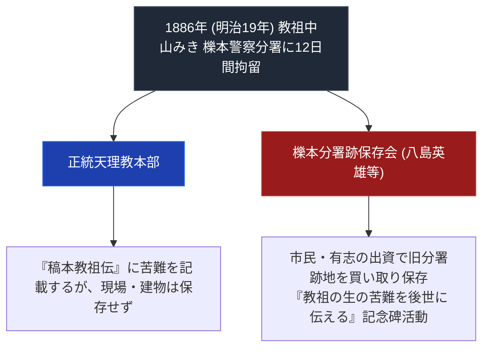

# 櫟本分署跡保存会 専門分析ノート

> [!summary] 要旨
> 櫟本分署跡保存会は、1886年（明治19年）に教祖・[[中山みき]]が最後の警察拘留（12日間）を受けた歴史的遺構「旧櫟本警察分署」の跡地を保存・顕彰するために、[[八島英雄]]等の民間有志が1979年に発足させた保存会である。**教会・宗教拠点ではなく、遺構の保全と教祖伝の史実検証を目的とする民間保全組織**であり、天理教本部の公式管理下にはない。1987年には櫟本の土地を買い入れ、新館を上棟して保存活動の拠点とした。

---

## 1. 命題の構造（教祖最後の受難地 vs 本部歴史不保存への批判）

---

## 2. 基本情報

| 項目 | 内容 |
| :--- | :--- |
| **名称** | 櫟本分署跡保存会 |
| **種別** | 民間遺構保全組織（教会・宗教法人ではない） |
| **発足** | 1979年2月25日（保存呼びかけは同年1月27日） |
| **創設代表** | [[八島英雄]]（1929-2014）。現在の代表者は未確認 |
| **所在地** | 〒632-0004 奈良県天理市櫟本町3071（旧櫟本警察分署跡。NAVITIME掲載情報による） |
| **対象遺構** | 旧櫟本警察分署跡（教祖・中山みき最後の拘留地） |
| **公式発信** | note（櫟本分署跡保存会）、公式サイト ichinomoto.com（存在のみ確認、内容は未取得） |

---

## 3. 起源と成立の経緯

- 1886年（明治19年）、教祖・中山みきは櫟本警察分署に引致され、2月18日から3月1日まで12日間拘留された（保存会発足文書による。[[中山みき]]ノートでも1886年・12日間・最後の拘留であることは確認済み）。教祖は当時89歳（数え年）であった。
- 天理教ではこの拘留を「最後の御苦労」と称する。
- 1979年1月27日、八島英雄が『ほんあづま』発刊十周年記念行事として、教祖最後の御苦労の場である櫟本分署跡の保存を呼びかけた（櫟本分署跡保存会note「八島英雄先生の歩み」）。
- 同年2月25日、保存呼びかけの集いが開かれ、櫟本分署跡保存会が発足した。

---

## 4. 沿革・歴史変遷

- 1979年1月27日: 保存の呼びかけ。
- 1979年2月25日: 保存会発足。
- 1980年5月: 櫟本分署跡講座開始。6月から研修ツアー・史跡見学を開始。9月25日に参考館オープン。
- 1987年1月26日: 八島英雄『中山みき研究ノート』出版。同年、櫟本の土地を買い入れ、3月7日に新館上棟式。教祖の教えられた寸法のかんろだいを据えた。
- 2008年まで: 地域の史跡ウォークラリーにスタンプポイントとして参加・協力。
- 2014年10月23日: 創設代表の八島英雄が死去。

（以上、櫟本分署跡保存会note「八島英雄先生の歩み」による）

---

## 5. 内容の深層解剖（保存会の主張と活動）

- 保存会の主張の核心は、教祖の「生の苦難」の現場である遺構を保存し後世に伝えること、および公式教祖伝『稿本教祖伝』に対する史料批判（[[八島英雄の中山みき研究ノート（異説内容要約）]]参照）にある。
- 活動は、跡地の保存・顕彰、連続講座（櫟本分署跡講座）、研修ツアー・史跡見学の実施、参考館の運営など、顕彰・教育型のものである。
- 保存会は宗教儀礼を行う教会組織ではなく、その活動は信者の拠点としての教会活動とは区別される。

---

## 6. 宗教学的・歴史社会学的意義

- 教団本部が保存しなかった受難地遺構を、内部の教会長経験者を含む民間有志が買い取り保存した事例として、宗教的記憶の保存主体をめぐる問題（本部 vs 周辺信者）を示す。
- 史跡保存運動と教祖伝の史実検証運動（原典主義）が一体となった運動であり、天理教内部の異説運動の物質的基盤となった。

---

## 7. 拠点・現地情報

- **所在地**: 〒632-0004 奈良県天理市櫟本町3071（旧櫟本警察分署跡地。番地はNAVITIMEの掲載情報による）
- **電車アクセス**: JR桜井線（万葉まほろば線）「櫟本駅」下車、徒歩約5分
- **自動車アクセス**: 西名阪自動車道「天理IC」より国道169号線を北へ約3分
- 櫟本駅の駅周辺案内でも「櫟本警察分署跡（天理教教祖拘留の地）」として紹介されている（Wikipedia「櫟本駅」）。

---

## 8. 関連教団・関連人物・関連概念

- [[八島英雄]]
- [[中山みき]]
- [[明治の教難と教祖牢くぐり]]
- [[稿本天理教教祖伝]]
- [[八島英雄の中山みき研究ノート（異説内容要約）]]

---

## 9. 史料・一次資料 (convMD)

- [[src_八島英雄_保存会note]] — 櫟本分署跡保存会 note「八島英雄先生の歩み」（convMD取込）。発足日・土地買入れ・講座開始等の典拠
- [[src_中山みき_Wikipedia]] — Wikipedia「中山みき」。1886年の最後の拘留（12日間・櫟本分署）の裏付け

---

## 10. 参考文献・学術論文

- 櫟本分署跡保存会 note「八島英雄先生の歩み」 https://note.com/ichinomoto185/n/n3de026a5cb5e
- NAVITIME「櫟本分署跡保存会」地点情報（住所・郵便番号の確認に使用、2026-11-15検索）

---

## 11. 関連ノート (Vault内)

- [[八島英雄]]
- [[中山みき]]
- [[明治の教難と教祖牢くぐり]]
- [[八島英雄の中山みき研究ノート（異説内容要約）]]
- [[_分派・異端研究ポータル]]

---

## 12. 留保（中立的併記・未確定要素）

> [!warning] 留保事項
> - **位置づけの正確化**: 本会は教会・宗教拠点ではなく、遺構保存を目的とする民間保全組織である。第1波の照合でも確定したとおり、本会を「陽気づくめ教会」の拠点とする裏付けは保存会側資料にない（[[陽気づくめ教会拠点一覧]]における分類はハブ波での処理事項）。
> - 設立年（1979年2月25日発足）・創設代表（八島英雄）は保存会noteで確認済み。ただし八島は2014年に死去しており、現在の代表者は未確認である（旧稿frontmatterは八島を現代表者のように記載していたため是正した）。
> - 拘留の回数（旧稿の「12回目」）は、拘留の総回数自体が資料により異なり [[中山みき]]・[[天理教]] の各ノートでも未検証として分離されているため、本ノートでは「最後の拘留」とのみ記し回数は断定しない。
> - 所在地の番地（3071）はNAVITIME（タウンページ提供情報）によるもので、保存会公式資料での直接確認は未実施。公式サイト ichinomoto.com の内容は未取得。
> - **改訂記録（2026-11-15・全件照合）**: 宗教版12セクションへ再編。(1) frontmatter（primary_source_based / 4）と留保（confidence 3）の不整合を解消し、[[八島英雄]]ノートにおける同一出典基盤の評価に合わせて `secondary_source_based` / `3` に統一した（保存会は代表者本人の関係団体であり、その発信は独立した裏付けとは扱わない）。(2) 土地買入れが発足時ではなく1987年であることを保存会noteに基づき明記した。(3) 所在地に番地（3071）を補い、出典を明示した。
> - 本ノートの evidence_type は `"secondary_source_based"`、confidence は `3`。

---

*※本稿は[[_分派・異端研究ポータル]]の史実遺構保全分析ノートである。*
