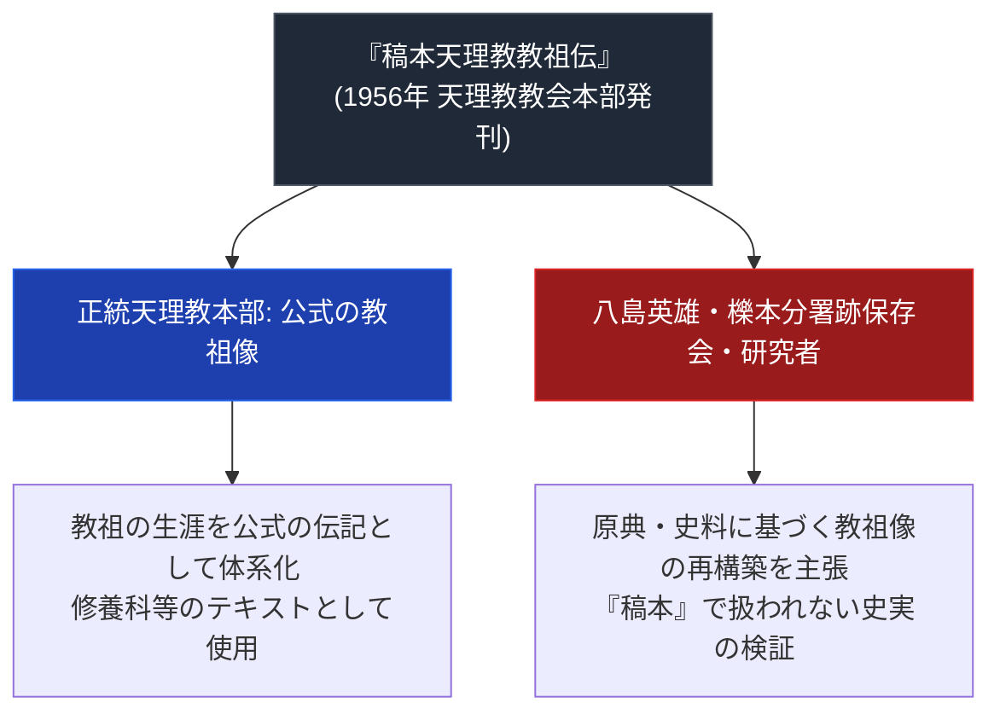

# 稿本天理教教祖伝

> [!summary] 要旨
> 『稿本天理教教祖伝』は、天理教教会本部が編纂した教祖・[[中山みき]]の公式伝記である。大正期に教祖50年祭を記念して完成した『御教祖伝史実校訂本』を基に、教祖70年祭を記念して二代真柱・[[中山正善]]の指導の下で編集・改訂され、1956年（昭和31年）10月26日に教会本部より発刊された（Wikipedia「天理教」）。その後1981年・1986年・2016年に三度の改訂が加えられている。本稿では書誌的事実をNDLサーチとWikipediaで照合し、[[八島英雄]]らによる批判の存在と、「稿本」の由来をめぐる異説（出典未取得の資料に基づく）を併記する。

---

## 1. 命題の構造（公式伝記 vs 批判的検証）

- Wikipedia「天理教」は、教会本部編纂の『稿本天理教教祖伝』において立教以後のみきは神性が強調され人間性は問われないとする批判があることを紹介し、青地晨『天理教 百三十年目の信仰革命』の指摘、天理大学付属おやさと研究所・幡鎌一弘の指摘を挙げている。
- [[八島英雄]]は著書『中山みき研究ノート』（立風書房、1987年）で公式教祖伝『稿本教祖伝』を批判し、原典に基づく教祖像の再構築を主張した（[[八島英雄]]ノートの照合で確認）。稿本教祖伝の記述内容と保存会側の主張との具体的な対立点の逐語的突合は未実施である。

---

## 2. 基本情報

| 項目 | 内容 |
| :--- | :--- |
| **書名** | 『稿本天理教教祖伝』 |
| **編者** | 天理教教会本部 編（NDLサーチの書誌情報による）。二代真柱の指導の下で編集された（Wikipedia「天理教」） |
| **発刊** | 1956年（昭和31年）10月26日、教会本部より発刊 |
| **基となった書** | 大正期に教祖50年祭を記念して完成した『御教祖伝史実校訂本』（Wikipedia「天理教」。ただし§3の異説も参照） |
| **改訂** | 1981年（昭和56年）、1986年（昭和61年）、2016年（平成28年）に三度の改訂 |
| **位置づけ** | 天理教の公式の教祖伝。修養科では『天理教教典』とともに教義を学ぶテキストとして用いられる（Wikipedia「天理教」） |

---

## 3. 起源と成立の経緯（編纂史）

- 大正期、教祖50年祭を記念して『御教祖伝史実校訂本』が完成した。
- 教祖70年祭を記念し、二代真柱の指導の下で編集・改訂されたものが『稿本天理教教祖伝』として1956年10月26日に発刊された（以上、Wikipedia「天理教」の「稿本天理教教祖伝」節による）。
- **異説（未検証・出典未取得）**: 旧稿§3-1が紹介していた yousun.sakura.ne.jp 掲載PDF資料（幡鎌一弘の研究を引用するとされる）は、稿本教祖伝は初代真柱・中山眞之亮による「稿本教祖様御伝」「教祖様御伝」を根本に、1928年（昭和3年）の「おふでさき註釈」の枠内で作成され、『御教祖伝史実校訂本』を直接の土台にしたものではないとする。これはWikipedia「天理教」の記述（『御教祖伝史実校訂本』が基）と食い違う。当該PDFは旧稿が参照名 `src_topatu_shimazono_ronsou` で言及していたが資料フォルダに実在せず、今回も取得できなかったため**未取得**であり、異説の内容は旧稿の要約の範囲で併記するに留める。

---

## 4. 変遷・歴史

- 1956年10月26日：発刊（教祖70年祭記念）。
- 1981年・1986年・2016年：三度の改訂（Wikipedia「天理教」）。
- 書名の「稿本」が現在も外されていない経緯については、八島英雄の証言を紹介する資料（§3の異説）があるが、出典資料が未取得のため確定情報としては扱わない。

---

## 5. 内容・様式の深層解剖

- 対象は教祖・中山みきの誕生から1887年（明治20年）の死去（現身を隠したこと）までの生涯である（幡鎌一弘は、教祖死去の明治20年で終わる『稿本天理教教祖伝』の枠組みそのものが中山みきの物語を狭めているのではないかと述べている。Wikipedia「天理教」による）。
- 「貧に落ち切れ」の記述をめぐっては、八島英雄のほか島田（『日本の10大新宗教』）、早川（『天理教・その堕落と悲劇』）が、実際は長男・秀司の相場の失敗による借金であったと指摘していることがWikipedia「天理教」に紹介されている。

---

## 6. 宗教学的・歴史社会学的意義

- 『稿本天理教教祖伝』は、天理教の公式歴史言説の中心テキストであり、その編纂・改訂の経緯自体が、教団の正統性の担保と教祖像の神聖化をめぐる研究対象となっている。
- 「突発説」（教祖は神の意志を伝える存在という理解）と「教祖成人説」（教祖の内面的な成人過程を重視する理解）の対立が本書をめぐって論じられてきたことは、§3の異説資料が示唆するが、出典未取得のため本稿では論点の存在の紹介に留める。

---

## 7. 拠点・現地情報

- 発刊主体は天理教教会本部（奈良県天理市）。
- [[八島英雄]]が主宰した[[櫟本分署跡保存会]]は、教祖が最後に拘留された櫟本分署跡（奈良県天理市櫟本町）を本部とは別に保存する活動を行っている（[[八島英雄]]ノート参照）。

---

## 8. 関連教団・関連人物・関連概念

- [[中山みき]]
- [[中山正善]]
- [[八島英雄]]
- [[櫟本分署跡保存会]]
- [[おふでさき]]
- [[みかぐらうた]]

---

## 9. 史料・一次資料 (convMD)

- [[src_稿本天理教教祖伝_NDLサーチ]]（国立国会図書館サーチの書誌情報：『稿本天理教教祖伝』、天理教教会本部 編、1956年）
- [[src_天理教_Wikipedia]]（Wikipedia「天理教」。発刊日・編纂史・改訂年・批判の紹介の確認に使用）
- yousun.sakura.ne.jp掲載PDF（「なぜ『天理教』は突発説にこだわるのか？」島薗進論争資料）：旧稿が参照名 `src_topatu_shimazono_ronsou` で言及していたが資料フォルダに実在せず、今回も取得できなかったため**未取得**

---

## 10. 参考文献・学術論文

- 『稿本天理教教祖伝』（天理教教会本部、1956年。1981年・1986年・2016年改訂）
- 八島英雄『中山みき研究ノート』（立風書房、1987年）
- 青地晨『天理教 百三十年目の信仰革命』（Wikipedia「天理教」が批判の出典として紹介）

---

## 11. 関連ノート (Vault内)

- [[中山みき]]
- [[中山正善]]
- [[八島英雄]]
- [[櫟本分署跡保存会]]
- [[おふでさき]]
- [[_分派・異端研究ポータル]]

---

## 12. 留保（中立的併記・未確定要素）

> [!warning] 留保事項
> - **確定（書誌）**: 『稿本天理教教祖伝』（天理教教会本部 編、1956年）はNDLサーチの書誌情報で実在を確認した。発刊日1956年10月26日・編纂史（『御教祖伝史実校訂本』を基に二代真柱の指導の下で編集）・改訂年（1981年・1986年・2016年）はWikipedia「天理教」で確認した。[[中山家系図]]ノートの参考文献記載とも一致する。
> - **未検証・未取得**: §3の異説（編纂の直接の土台をめぐる幡鎌研究の紹介、および「稿本」の文字が外されなかった経緯に関する八島英雄の証言）は、出典である yousun.sakura.ne.jp 掲載PDFが未取得のため、内容を確定情報として扱わない。Wikipediaの記述と食い違う点は両論併記とした。
> - **未検証**: 稿本教祖伝の記述内容と[[櫟本分署跡保存会]]側の主張との具体的な対立点は、逐語的突合が未実施のため未検証である。
> - **是正（evidence_type / confidence）**: 旧稿は frontmatter が `primary_source_based` / confidence `4`、留保内では confidence `3` と不整合だった。書誌確認はNDL（公的DB）で行ったが、編纂史・内容の確認はWikipedia等の二次資料に基づくため、`secondary_source_based` / `3` に統一・是正した。
> - **改訂記録（2026-11-15・全件照合）**: 12セクションへの構造正規化、編纂史・改訂年の確定、異説の未取得明示、上記の是正を実施。バックアップは監査フォルダに保存済み。

---

*※本稿は[[_分派・異端研究ポータル]]の公式伝記分析ノートである。*
