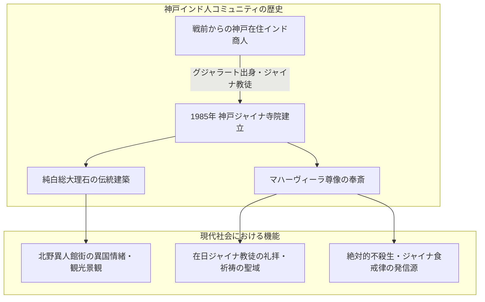

# バグワン・マハビールスワミ・ジェイン寺院（神戸ジャイナ寺院） 専門構造分析ノート

> [!warning] 執筆前の確認事項
> - **バグワン・マハビールスワミ・ジェイン寺院（Bhagwan Mahavir Swami Jain Temple）**は、兵庫県神戸市中央区北野町（北野異人館街）に所在するジャイナ教寺院である。本格的なジャイナ寺院としては日本国内で唯一とされる（留保参照）。
> - 戦前より神戸に定住し、真珠・生糸・綿花・宝石貿易に従事してきたインド・グジャラート州出身のジャイナ教徒コミュニティが、1985年に総大理石で建立した（Feel KOBE 神戸公式観光サイト）。
> - ジャイナ教の最終救済者（第24代ティールタンカラ）である**「マハーヴィーラ（大雄尊者）」**を主神として奉斎する。
> - なお本寺院はジャイナ教の施設であり、シク教の施設（日本シク教共同体のグルドワラ等）とは別宗教である。

> [!summary] 要旨
> **神戸ジャイナ寺院**は、日本におけるジャイナ教信仰の中心的拠点である。インドから取り寄せた純白の大理石で作られ、繊細な彫刻や金属の扉などインドの伝統建築様式を再現している（Feel KOBE）。神戸の多文化共生都市としての歴史を体現する宗教施設であり、在日インド人コミュニティの精神的支柱として機能している。拝観時間は日曜・祝日13:00〜15:00、もしくは事前予約による（Feel KOBE）。

---

## 1. 命題の構造（通説・正統本部 vs 本教団・自説）

### 比較考察マトリクス表

| 比較軸 | 一般観光客・北野異人館散策者（etic） | ジャイナ教徒・宗教学的視点（emic） |
| :--- | :--- | :--- |
| **建築の認識** | 異人館街にあるエキゾチックで美しい白亜のインド宮殿 | 輪廻の苦海を渡る**「ティールタ（渡瀬・救済の聖地）」** |
| **主神の捉え方** | 瞑想するインドの神様像 | 欲望と業（カルマ）を完全に滅尽した**勝利者（ジーナ / マハーヴィーラ）** |
| **不殺生（アヒムサー）** | 動物を大切にするベジタリアン思想 | 微生物・虫・植物の根すら傷つけない**魂の解脱への絶対要件** |
| **参拝・入場規律** | 珍しい寺院の見学スポット | 清浄な衣服・革製品（動物の皮）の持ち込み厳禁の**至高の清浄域** |

---

## 2. 基本情報

| 項目 | 内容 |
| :--- | :--- |
| **寺院名** | バグワン・マハビールスワミ・ジェイン寺院（Bhagwan Mahavir Swami Jain Temple） |
| **設立年** | 1985年（昭和60年）6月1日開廟 |
| **所在地** | 兵庫県神戸市中央区北野町3-7-4 |
| **主神（本尊）** | **バガワーン・マハーヴィーラ（Bhagwan Mahavir / 尊称：マハビールスワミ）** |
| **建築構造** | インドから取り寄せた純白の大理石、インド伝統寺院建築様式。砂岩も併用されるとされる |
| **所属宗派** | 白衣派（シュヴェーターンバラ派） |
| **管理主体** | 神戸ジャイナ協会（Jain Sangh of Kobe） |

---

## 3. 創始者と天啓・社伝

ジャイナ教の開祖（第24代ティールタンカラ）マハーヴィーラは紀元前6世紀の人物で、釈迦と同時代とされる。本寺院は特定の「創始者」による立教ではなく、在日ジャイナ教徒コミュニティによる建立である。

---

## 4. 沿革・歴史変遷（検挙・裁判・不敬罪・治安維持法弾圧等）

### (1) 神戸港開港とインド商人の定住
1868年の神戸開港に伴い、イギリス領インド帝国から綿花・生糸・真珠・紅茶などを扱うインド商人が来日。大正・昭和初期にかけて神戸・北野町周辺にインド人コミュニティが形成された。

### (2) 1985年の寺院建立
長年、自宅や集会場で礼拝を行っていた在日ジャイナ教徒たちが私財を拠出し、インド本国から大理石彫刻職人を招聘して1985年に寺院が建立された。マハーヴィーラ像は1984年にムンバイから空輸されたとされる（複数資料の紹介による）。

---

## 5. 教理・儀礼・神観の深層解剖

### 5-1. アヒムサー（非暴力・不殺生）の極致
ジャイナ教徒は、あらゆる生命に対する暴力を禁じる。
1. **動物性食材の完全厳禁**: 肉・魚・卵はもちろん、動物性添加物や革製品も忌避。
2. **根菜類（地下茎野菜）の完全禁忌**: タマネギ、ニンニク、ジャガイモ、生姜、人参、大根などは、掘り起こす際に土中の微細な生物を殺傷し、また1つの根に無数の生命（アナンタカーヤ）が宿るとされるため一切口にしない。
3. **発酵食品・キノコ類の制限**: 微生物の繁殖や腐敗を避けるため、キノコや蜂蜜、過度な発酵物を控える。

### 5-2. 日本の飲食業界への波及
神戸ジャイナ寺院の存在と、近年のIT・宝石産業の発展により、東京（御徒町・西葛西）や関西のインド料理店において**「ジャイナ対応（No Onion, No Garlic, No Potato）」**の専用メニューが普及する契機となったとされる。

---

## 6. 宗教学的・歴史社会学的意義

神戸・北野は、キリスト教・イスラム教・ユダヤ教・ジャイナ教など多様な宗教施設が半径400mほどのエリアに共存する地域として、神戸市公式観光サイト（Feel KOBE）でも紹介されている。本寺院はその一翼を担い、在日インド人コミュニティの宗教的・文化的拠点として機能している。

---

## 7. 拠点・現地情報

- **所在地**: 兵庫県神戸市中央区北野町3-7-4（Feel KOBE 神戸公式観光サイト）
- **拝観時間**: 日曜・祝日 13:00〜15:00、もしくは事前予約（Feel KOBE）
- **アクセス**: JR・阪急・阪神・地下鉄「三宮駅」または山陽新幹線「新神戸駅」より北野坂を北へ徒歩約15分
- **参拝の注意**: 観光施設ではなく宗教施設であるため、信徒以外の内部立ち入りは事前許可や礼儀（靴脱ぎ、革製品持ち込み禁止、静粛）が求められる

---

## 8. 関連教団・関連人物・関連概念

- **マハーヴィーラ**: 紀元前6世紀のジャイナ教開祖（釈迦と同時代）
- **アヒムサー（Ahimsa）**: 不殺生の最高徳目
- **[[ヴェジハーブサーガ（VEGE HERB SAGA）]]**: 御徒町のジャイナ対応南インド料理店
- **[[Veg Kitchen（ベジキッチン・仲御徒町）]]**: 仲御徒町の100%ピュアベジ・ジャイナ対応店
- **[[ナタラジ（NATARAJ・自然派インド料理）]]**: 日本における完全菜食インド料理のパイオニア
- **[[ゴヴィンダス（Govinda's）船堀店]]**: ヒンドゥー教（ISKCON）の五葷抜き菜食寺院レストラン
- **[[神戸関帝廟]]**: 神戸における外来華僑道教廟（比較対象）

---

## 9. 史料・一次資料 (convMD)

- [[src_神戸ジャイナ寺院_FeelKOBE]] — Feel KOBE 神戸公式観光サイト「多種多様な『宗教施設』が共存する神戸北野でダイバーシティを感じる街歩き」（所在地・建立年・拝観時間の出典）

旧稿が出典としていた feel-kobe の施設詳細ページ（detail.php?id=377）は2026-11-15時点で404（リンク切れ）のため、上記の現行ページに付け替えた。

---

## 10. 参考文献・学術論文

- 渡辺研二『ジャイナ教聖典選』（平凡社東洋文庫）— 旧稿記載。今回の照合では書誌の直接確認は未実施
- 河野亮仙『インドの宗教と食文化』（東方出版）— 旧稿記載。同上

---

## 11. 関連ノート (Vault内)

- [[ヴェジハーブサーガ（VEGE HERB SAGA）]]
- [[Veg Kitchen（ベジキッチン・仲御徒町）]]
- [[ナタラジ（NATARAJ・自然派インド料理）]]
- [[ゴヴィンダス（Govinda's）船堀店]]
- [[神戸関帝廟]]
- [[各教団の食の教義・タブー比較]]

---

## 12. 留保（中立的併記・未確定要素）

> [!warning] 留保事項
> - **改訂記録（2026-11-15・全件照合）— 旧稿の訂正**:
>   1. **所在地**: 旧稿「北野町3-1-8」→ Feel KOBE（神戸公式観光サイト）に基づき **北野町3-7-4** に訂正した。なお一部の資料には「3-7-5」との表記も見られるため、番地の最終確定には現地確認を要する
>   2. **出典URLのリンク切れ**: 旧稿の feel-kobe 施設詳細ページは404のため、現行のモデルコースページに付け替えた。旧稿にあった「インド大使館アーカイブ」という出典は実在を確認できなかったため削除した
>   3. **evidence_type の是正**: 旧稿の `primary_source_based` / confidence `5` は、出典の実態（観光サイト等の二次資料）に合わないため、`secondary_source_based` / confidence `4` に是正した
> - **「日本国内唯一」の表現について**: 観光資料等では「日本国内唯一のジャイナ教寺院」と紹介されることが多いが、東京・台東区に小規模なジャイナ教礼拝所（デラサール）の記録もあり、2019年以降の活動が確認できない。本ノートでは「本格的なジャイナ寺院としては国内唯一とされる」と表現を弱めた
> - **必須点検a**: 法人番号の記載なし（施設ノートのため該当なし）
> - **必須点検b**: 教典名の記載なし。§10の2冊は旧稿記載の書誌であり、今回の照合では直接確認していない旨を明記した
> - **必須点検c**: §9の src_ 参照は実在ファイルであることを確認した
> - 建築の詳細（ラジャスタン産大理石、シカラ屋根等）は旧稿の記述を残したが、Feel KOBEの記述は「インドから取り寄せた純白の大理石」「繊細な彫刻や金属の扉」までであり、産地等の細部は未確認
> - 本ノートの evidence_type は `secondary_source_based`、confidence は `4`（公的観光サイトで所在地・建立年を確認できるが、教理・建築の細部は二次資料に依拠するため）。

---

*※本稿は[[_分派・異端研究ポータル]]の外来宗教およびジャイナ教寺院に関する専門構造分析ノートである。*
