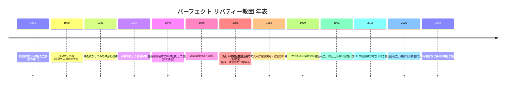

# パーフェクト リバティー教団（PL教団） 専門構造分析ノート

> [!summary] 要旨
> パーフェクト リバティー教団（通称：PL教団、英語：Church of Perfect Liberty）は、御木徳一を初代教祖とする新宗教。前身は1916年（大正5年）に立教された御嶽教徳光大教会で、扶桑教への転属を経て「ひとのみち教会」と称したが、1937年に不敬罪で解散させられた。戦後の1946年（昭和21年）に第2代教祖・御木徳近（1900-1983）が佐賀県鳥栖市でPL教団として再立教し、1953年に大阪府富田林市へ本部を移した。宇宙全体＝神である「大元霊（みおやおおかみ）」を信仰対象とし、「**人生は芸術である**」を中核に据える。戦後、立正佼成会や世界救世教らと共に「新日本宗教団体連合会（新宗連）」を結成し、徳近が初代理事長に就任した。高校野球の名門「PL学園」や「教祖祭PL花火芸術」で高度経済成長期に広く知られた。第3代教祖・御木貴日止（1957-2020）の死去後は未亡人の御木美智代が教主代行を務め、2026年2月22日に第4代教祖に就任した。

---

## 1. 命題の構造（通説・正統本部 vs 本教団・自説）

PL教団は、御嶽教・扶桑教の教会から独立した教団である。前身組織の変遷については資料により起点の取り方（1916年・1924年・1946年）が異なり、本ノートではWikipediaの沿革記述を主線とする（留保参照）。旧稿が引く系統説では、幕末・明治の神道霊学の流れ（金田徳水の徳水霊感教）から御木徳一が神示を継承したとされるが、この継承関係は今回照合したWikipedia・RIRCでは確認できなかった（留保参照）。

| 比較考察軸 | 扶桑教（前身所属教派） | パーフェクト リバティー教団 (PL教団) |
| :--- | :--- | :--- |
| **主祭神・信仰対象** | 富士山信仰・山岳信仰・国家神道系 | 大元霊（みおやおおかみ。宇宙全体＝神）、教神、各家の祖霊 |
| **中心聖地・拠点** | 富士山・御嶽山 | 大本庁聖地（大阪府富田林市）、大平和祈念塔 |
| **中心教理・象徴概念** | 山岳修行・国家祭祀 | **「人生は芸術である」**（PL処世訓21ヵ条の実践、みしらせ・神示受受） |
| **創始者・啓示の経緯** | 宍野半（扶桑教祖）の富士山開山 (1881) | 御木徳一による立教 (1916) |
| **聖典・原典** | 教典・祝詞 | 『PL教典』『PL処世訓』『PL信仰生活心得』（RIRC記載） |

---

## 2. 基本情報

| 項目 | 内容 |
| :--- | :--- |
| **教団正式名称** | 宗教法人 パーフェクト リバティー教団（通称：PL教団） |
| **歴代教祖（おしえおや）** | 初代：御木徳一 / 第2代：御木徳近（1900-1983） / 第3代：御木貴日止（1957-2020） / 第4代：御木美智代（2026年就任） |
| **創立年・再立教** | 1916年（御嶽教徳光大教会立教） / 1946年（PL教団再立教） / 1952年（宗教法人登記、RIRC） |
| **大本庁所在地** | 〒584-8555 大阪府富田林市大字新堂2172番地の1（大平和祈念塔・聖地境内） |
| **法人番号** | 3120105004781（国税庁法人番号公表サイトで商号・所在地の一致を確認） |
| **信仰対象** | 大元霊（みおやおおかみ、宇宙全体＝神）、教神、各家の祖霊（RIRC） |
| **核心教理・信条** | 「人生は芸術である」、PL処世訓21か条、みしらせ・神示受受（神示生活指導） |
| **加盟連合組織** | 新日本宗教団体連合会（新宗連・結成原加盟団体、初代理事長教団） |
| **信者数** | RIRC範囲表記：国内100万～300万人・国外10万～50万人。教団側は海外を含む信者数を100万人以上と主張（Wikipedia、要出典とされる） |
| **主要関連事業** | 学校法人PL学園、医療法人宝生会PL病院、株式会社光丘（ゴルフ場・緑化事業） |

---

## 3. 創始者と天啓・社伝

PL教団では、神と信徒を媒介し神意を取り次ぐ最高指導者を「おしえおや（教祖）」と呼ぶ。

- **初代教祖：御木徳一**:
  1916年に御嶽教徳光大教会を立教。1928年に扶桑教へ転属し、1931年に「扶桑教ひとのみち教会」と改称した。病気や生活苦に悩む大衆に対し、神からの警告（みしらせ）を読み解く生活指導を行い信徒を獲得したが、1937年の弾圧で検挙され、教会は解散した（生没年等の詳細は留保参照）。
- **第2代教祖：御木徳近（1900-1983）**:
  徳一の後継者。終戦後の1946年に佐賀県鳥栖市でPL教団として再立教を果たした教団中興の祖。「人生は芸術である」を提唱し、新日本宗教団体連合会（新宗連）の初代理事長を務め、富田林大本庁の造営、PL学園の開校、花火大会の創始など、教団の拡大期を築き上げた。1983年2月2日に死去。
- **第3代教祖：御木貴日止（1957-2020）**:
  徳近の死去に伴い1983年に第3代教祖に就任。2020年12月5日に死去した。
- **第4代教祖：御木美智代**:
  貴日止の未亡人。貴日止の死去後、教主代行を務め、2026年2月22日に第4代教祖となった（Wikipedia年表・教祖一覧表）。

---

## 4. 沿革・歴史変遷



```
・1916年: 御嶽教徳光大教会が立教（初代教祖・御木徳一）
・1928年: 扶桑教に転属、「扶桑教人道徳光教会」と称す
・1931年: 「扶桑教ひとのみち教会」と改称
・1937年: 不敬罪により教祖が逮捕・起訴され、教会は解散（起訴内容は後に取り消し）
・1946年: 御木徳近が佐賀県鳥栖市にてPL教団を立教
・1949年: 静岡県清水市へ移転
・1951年: 立正佼成会、世界救世教らと共に「新日本宗教団体連合会（新宗連）」を結成、徳近が初代理事長就任
・1952年: 宗教法人登記（RIRCの法人登記年）
・1953年: 大阪府富田林市に大本庁の建設を開始。教祖祭PL花火芸術が始まる
・1955年: 学校法人PL学園を設立（旧稿記載）
・1970年: 高さ180mの「大平和祈念塔」を竣工
・1983年: 第2代教祖・御木徳近死去。御木貴日止が第3代教祖に就任
・2016年: PL学園硬式野球部が大阪予選を最後に休部
・2020年: 第3代教祖・御木貴日止死去。未亡人・御木美智代が教主代行に
・2026年: 御木美智代が第4代教祖に就任
```

---

## 5. 教理・儀礼・神観の深層解剖

### 1. 「人生は芸術である」とPL処世訓21ヵ条
PL教団の教義は、難解な来世思想や禁欲主義を排し、現世における個人の生き生きとした「自己表現」を最高善とする。
- **真理の定義**: 「人生は芸術である（Life is Art）」。人間は神（大元霊）の分霊であり、一人ひとりの個性と才能を世のため人のために表現することこそが、神への真の奉仕であると説く。RIRCの活動趣旨にも「『人生は芸術である』の真理の下に自他共に恵まれ幸いされる心境を悟得させ」ることが目的として記されている。
- **PL処世訓21ヵ条**: 信徒の日々の行動指針。Wikipediaに掲載される条文は次の通り（第2条・第3条・第11条・第12条・第16条・第21条は旧稿の引用と相違があったため、2026-11-15の照合で差し替えた）。
  - 第1条：人生は芸術である
  - 第2条：人の一生は自己表現である
  - 第3条：人は真の自己である
  - 第4条：一切に表現が現れる
  - 第5条：自己を失うと苦悩する
  - 第6条：自我に執着するな
  - 第7条：一切は消えては現れる
  - 第8条：明るく朗らかに生きてゆこう
  - 第9条：己に打ち克つは自己完成への道
  - 第10条：その日その日が晴舞台
  - 第11条：一切を神に依れ
  - 第12条：名に因って道がある
  - 第13条：物質も精神も共にある
  - 第14条：人生に真の目的がある
  - 第15条：希望を以て生きてゆこう
  - 第16条：一切は進歩発展する
  - 第17条：悟りは平和への道
  - 第18条：常に自我を省みよ
  - 第19条：常に中心を求めよ
  - 第20条：各々の持ち味を活かそう
  - 第21条：真の自由に生きよ

### 2. 「みしらせ」と「おしえおや」の神示受受
PL教団の最も特徴的な信仰実践法（以下は旧稿の教理記述を転記）。
- **みしらせ（神の警告）**: 信徒の身に生じる病気、ケガ、失業、事業失敗、夫婦喧嘩などのあらゆる苦難・災難は、偶然ではなく「自己中心的な間違った心遣い（思い癖）」に対する神（大元霊）からの愛の警告（みしらせ）であると解釈する。
- **神示受受（じゅじゅ）**: 信徒は苦難に直面した際、教会長を通じて「おしえおや（教祖）」に事情を報告し、神示（みしらせの意味と正すべき心の持ち方）を乞い受ける。その指導に従って生活態度や考え方を反省・改善することで、苦難が解消し幸福が得られると説く。

### 3. 一の日詣（いちのひまいり）と定例祭事
信徒は毎月「1」の付く日に大本庁または全国の教会に参拝する規律を持つ（旧稿記載）：
- **毎月1日（平和の日）**: 世界平和を祈念する式典。
- **毎月11日（先祖の日）**: 祖霊に感謝を捧げる慰霊式典。
- **毎月21日（感謝の日）**: 日常の神の恵みに感謝する式典。

### 4. 教祖祭PL花火芸術と大平和祈念塔
- **教祖祭PL花火芸術**: 1953年から2019年までの66年間、毎年8月1日に富田林市の光丘カントリー倶楽部で開催された教団最大級の花火大会。しかし、新型コロナウイルス感染症の流行した2020年から2025年まで6年連続で中止となり、2026年現在に至っても再開・廃止の情報は発表されていない（Wikipedia）。
- **大平和祈念塔**: 正式名称「超宗派万国戦争犠牲者慰霊大平和祈念塔」（通称：大平和塔、PLタワー）。1970年竣工、高さ180m。特定の一教派や国籍を問わず、人類史上のあらゆる戦争犠牲者を合祀・慰霊する目的で建立された。

---

## 6. 宗教学的・歴史社会学的意義

> [!danger] 1937年「ひとのみち教会事件」と戦前の宗教弾圧
> - **不敬罪による解散**:
>   1937年、前身「ひとのみち教会」は、教祖・御木徳一が不敬罪で逮捕・起訴され、教会は解散を余儀なくされた（起訴内容は後に取り消された）。戦前の国家神道体制下における新宗教弾圧の代表例の一つとされる。
> - **戦後の再出発**:
>   敗戦後の1946年、PL教団として再立教し、「人生は芸術」という日常生活密着型の教えで都市部を中心に拡大した。

PL教団は、戦前の弾圧を経験した新宗教が戦後に教派神道系の枠組みから独立し、日常生活の実践を中心とする教えで大衆化した事例として位置づけられる。PL学園野球部や教祖祭花火大会を通じて、教団名が一般社会に広く浸透した点も特徴である。

### PL学園の盛衰（旧稿記録）
> [!important] 昭和の栄光と平成・令和における縮小の軌跡（旧稿の記録を転記。個別数値の再照合は未実施＝留保参照）
> - **学校法人PL学園と高校野球**:
>   1955年に創設されたPL学園は、全寮制のもとで「信仰による精神修養」と「文武両道」を徹底したとされる。硬式野球部は甲子園で春3回・夏4回の優勝（春夏通算7回制覇）を果たし、桑田真澄・清原和博（KKコンビ）ら日本プロ野球を代表する選手を多数輩出したと記録される。
>   しかし、部内暴力不祥事の発覚や教団全体の信徒数減少に伴い、2016年夏の大阪予選を最後に硬式野球部は休部した（Wikipediaも2016年7月の大阪予選を最後に休部と記す）。
> - **教祖祭PL花火芸術**:
>   毎年8月1日に富田林の大本庁で開催された花火大会は、かつて数十万人の観客を集めたとされる。2020年以降は中止が続いている（5節参照）。

---

## 7. 拠点・現地情報

- **大本庁（富田林聖地）**:
  - 所在地：〒584-8555 大阪府富田林市大字新堂2172番地の1
  - アクセス：近鉄長野線「富田林駅」北口より近鉄バス約10分「PL病院正面所」等下車 / 阪神高速松原線「三宅出入口」より車で約30分
- **大平和祈念塔（PLタワー）**: 1970年竣工。高さ180m。大本庁聖地内に立つ超宗派の戦没者慰霊塔。
- **関連施設群**:
  - 医療法人宝生会 PL病院（富田林市）
  - PL学園中学校・高等学校、小学校、幼稚園、衛生看護専門学校（大本庁敷地内、Wikipedia）
  - 光丘カントリー倶楽部（ゴルフ場。教祖祭PL花火芸術の会場）

---

## 8. 関連教団・関連人物・関連概念

### 関連教団
- 扶桑教（前身の所属教派）
- 御嶽教（前身の系譜）

### 関連人物
- 御木徳一（初代教祖）
- 御木徳近（第2代教祖）
- 御木貴日止（第3代教祖）
- 御木美智代（第4代教祖）

### 関連組織・文化事業
- 学校法人PL学園
- 医療法人宝生会 PL病院
- 株式会社光丘（ゴルフ場経営、造園・緑化事業、境内地管理。旧稿記載）
- 人形劇団カッパ座（旧稿記載）
- 芸術生活社（教団出版局。機関誌『芸生新聞』『PL』の発行。旧稿記載）

### 関連概念
- 人生は芸術である、PL処世訓、みしらせ、神示受受

---

## 9. 史料・一次資料 (convMD)

- [[src_パーフェクトリバティー教団_Wikipedia]]（Wikipedia「パーフェクト リバティー教団」、convMD取込 2026-11-15）
- [[src_パーフェクトリバティー教団_国税庁法人番号]]（国税庁法人番号公表サイト、法人番号3120105004781の登録情報、convMD取込 2026-11-15）
- [[src_パーフェクトリバティー教団_RIRC]]（宗教情報リサーチセンター（RIRC）データベース、kyodan_db=o171、convMD取込 2026-11-15）
- [[src_大平和祈念塔_Wikipedia]]（Wikipedia「大平和祈念塔」、convMD取込 2026-11-15）

---

## 10. 参考文献・学術論文

1. パーフェクト リバティー教団 公式ウェブサイト (https://www.perfect-liberty.or.jp/)
2. 宗教情報リサーチセンター（RIRC）データベース「パーフェクト リバティー教団」（法人登記年1952年・本部所在地・信者数範囲表記・教典類を確認）
3. 井上順孝ほか編『新宗教事典』（弘文堂）（旧稿引用）

---

## 11. 関連ノート (Vault内)

- [[_分派・異端研究ポータル]]
- [[立正佼成会]]（新宗連創設の盟友教団）
- [[解脱会]]（新宗連創設の盟友教団）
- [[世界救世教]]（新宗連創設の盟友教団）
- [[系統別分類カタログ]]
- [[PL病院]]

---

## 12. 留保（中立的併記・未確定要素）

> [!warning] 留保事項
> - **法人番号**: 3120105004781 は国税庁法人番号公表サイトに実在し、商号「パーフェクト　リバティー教団」・所在地（大阪府富田林市大字新堂2172番地の1）が一致することを確認した（[[src_パーフェクトリバティー教団_国税庁法人番号]]）。
> - **教典名の実在確認**: 『PL教典』は実在する。RIRCデータベースが教典類として「ＰＬ教典 ＰＬ処世訓 ＰＬ信仰生活心得」を挙げ、家庭での信仰活動における「ＰＬ教典」の奏上にも言及している。ただし旧稿参考文献にあった書名形式『PL教典・PL処世訓21か条』（芸術生活社）という単行本としての実在は確認できなかったため、参考文献からは外した。
> - **立教年の表記差異**: 旧稿は「1924年『ひとのみち教団』立教」としていたが、今回照合したWikipediaの沿革では、1916年の御嶽教徳光大教会立教を起点とし、扶桑教転属（1928年、「扶桑教人道徳光教会」）を経て1931年に「扶桑教ひとのみち教会」と改称したとされる。本ノートはWikipediaの沿革を主線とし、1924年を起点とする表記（金田徳水からの神示継承を含む旧稿の系統説）は今回の照合資料では確認できなかったため、確定情報から外した（教団史等の一次資料による再確認は未実施）。
> - **教祖継承年の表記差異**: Wikipedia内の教祖一覧表は初代・徳一の在任を1916-1936年、徳近の就任を1936年とする箇所があるが、同記事の年表本文は徳近の死去を1983年2月2日とし貴日止の就任をその後とする。本ノートは年表本文（1983年継承）に拠った。初代教祖・御木徳一の生没年（旧稿は1871-1938）も今回の照合資料では確認できなかった。
> - **現在の指導体制の訂正（2026-11-15・全件照合）**: 旧稿は「教祖不在下の指導部合議制」としていたが、これは陳腐化した情報である。第3代教祖・御木貴日止の死去（2020年12月5日）後、未亡人の御木美智代が教主代行を務め、2026年2月22日に第4代教祖に就任した（Wikipedia年表・教祖一覧表。なお同記事のリード文は「教主は不在で美智代が教主代行」と旧い状態のままで、記事内部に表記差異がある）。
> - **信者数の訂正**: 旧稿の「公称約65万人〜100万人」「最盛期250万人」「実勢数万人規模へ減少推計」は出典が特定できなかったため確定情報から外し、RIRCの範囲表記（国内100万～300万人・国外10万～50万人）と教団側主張を併記する形に改めた。
> - **処世訓の引用訂正**: 旧稿のPL処世訓21ヵ条の引用は、Wikipedia掲載の条文と複数箇所で相違していた（第2条・第3条・第11条・第12条・第16条・第21条等）。本稿ではWikipedia掲載の条文に差し替えた。処世訓の制定年（旧稿は1947年）は今回の照合資料では確認できなかった。
> - **教祖祭花火の訂正**: 旧稿の「中止・非公開化」との表現を、Wikipediaの記述（1953年から2019年まで開催、2020年から2025年まで6年連続で中止、再開・廃止の公式発表なし）に改めた。
> - **旧稿転記部分**: 5節のみしらせ・一の日詣りの詳細、6節のPL学園の優勝回数・出身選手等の数値、7・8節の一部関連組織は旧稿の記録を転記したもので、今回の照合（Wikipedia・RIRC・国税庁）では個別に再確認していない。
> - **幽霊典拠の付け替え**: 旧稿の出典URLに含まれていた `src_modern_new_religions` は資料フォルダに実在しない（幽霊典拠）ため、実在する保存分（[[src_パーフェクトリバティー教団_Wikipedia]] 等）へ付け替えた。
> - 改訂記録（2026-11-15・全件照合）: 宗教版12セクションへ再編。evidence_type を旧稿の `academic_database`（7値外）から `academic_research` へ正規化し、confidence を 5 から 4 へ引き下げた（Wikipedia・RIRC・国税庁で主要事実を確認したが、立教年等の表記差異と旧稿転記部分が残るため）。
> - 本ノートの evidence_type は `academic_research`、confidence は `4`。

---

*※本稿は[[_分派・異端研究ポータル]]の個別教団分析ノートである。*
