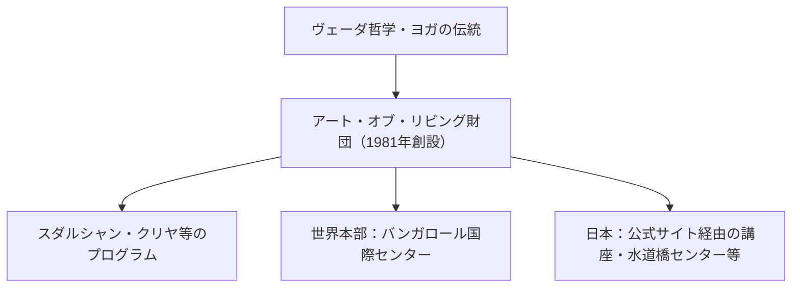

# アートオブリビング 専門構造分析ノート

> [!summary] 要旨
> アートオブリビング（The Art of Living Foundation）は、インドの霊性指導者スリ・スリ・ラビ・シャンカール（1956-）が1981年に創設した非営利の教育・人道支援組織である。リズミカルな呼吸法「スダルシャン・クリヤ」を中核とするストレス解消プログラム、瞑想、ヨガを世界各国で展開する。世界本部はインド・バンガロール（アート・オブ・リビング国際センター）。日本では公式サイト（artofliving.org/jp-ja）を通じて講座が案内され、東京・水道橋にセンターが置かれている。日本の法人格・法人番号は本照合では未確認である（12節）。

---

## 1. 命題の構造（通説・正統本部 vs 本教団・自説）

本組織は特定宗教の教団ではなく、ヴェーダ哲学・ヨガの伝統を背景とする国際的な霊性・教育NGOである。「宗教団体」としてではなく「呼吸法・瞑想プログラムを提供する国際NGO」として位置づけるのが実態に近い。

| 比較軸 | アート・オブ・リビング財団 | 備考 |
| :--- | :--- | :--- |
| 創設 | 1981年、スリ・スリ・ラビ・シャンカール | 英語版Wikipedia |
| 中核技法 | スダルシャン・クリヤ（呼吸法）、瞑想、ヨガ | 同上 |
| 組織形態 | 非営利の教育・人道支援NGO（財団） | 同上 |
| 展開規模 | 150カ国以上（資料により154〜180カ国と幅がある） | 公式各国サイト・Wikipedia |
| 日本法人 | 法人格・法人番号は未確認 | 本照合（12節） |

---

## 2. 基本情報

| 項目 | 内容 |
| :--- | :--- |
| **組織名称** | The Art of Living Foundation（アート・オブ・リビング財団） |
| **創始者** | スリ・スリ・ラビ・シャンカール（Gurudev Sri Sri Ravi Shankar、1956-） |
| **創設** | 1981年（インド） |
| **世界本部** | The Art of Living International Center（インド・カルナータカ州バンガロール） |
| **主な技法** | スダルシャン・クリヤ呼吸法、ヨガ、瞑想 |
| **日本公式サイト** | https://www.artofliving.org/jp-ja |
| **日本の法人格・法人番号** | 未確認（12節） |

---

## 3. 創始者と天啓・社伝

創始者スリ・スリ・ラビ・シャンカールは1956年生まれのインドの霊性指導者・人道活動家である。1981年にアート・オブ・リビング財団を創設した。中核技法のスダルシャン・クリヤは、呼吸のリズムを用いる技法として財団のプログラムの中心に置かれている（英語版Wikipedia）。

---

## 4. 沿革・歴史変遷

- 1981年：ラビ・シャンカールがアート・オブ・リビング財団を創設。
- 以後、呼吸法・瞑想プログラムを国際的に展開し、刑務所更生プログラムや紛争地域での活動など人道支援分野にも広がった（英語版Wikipedia）。
- 日本での活動開始時期・法人設立年は本照合では未確認（12節）。

---

## 5. 教理・儀礼・神観の深層解剖

### 5-1 中核プログラム
スダルシャン・クリヤは、固有のリズムを持つ呼吸法であり、ストレス軽減を目的とする財団の代表的プログラムである。あわせてヨガ、瞑想、自己啓発系の講座が提供される。

### 5-2 宗教性について
財団は特定の宗教への帰属を求める組織ではなく、ヴェーダ哲学・ヨガを背景とする霊性教育・人道支援NGOと自ら位置づけている。宗教学上はインド系の現代霊性運動の一事例として扱われる。

---

## 6. 宗教学的・歴史社会学的意義

インド発のグル中心型霊性運動が、呼吸法という身体技法を商品化・国際展開した代表例であり、「宗教」ではなく「ウェルネス／教育NGO」の形態で各国に進出する現代型の展開モデルとして注目される。

---

## 7. 拠点・現地情報

- 世界本部：The Art of Living International Center（バンガロール）。
- 日本：公式サイトのセンター一覧に「アートオブリビングハピネスセンター 水道橋」（東京都千代田区猿楽町2-7-11 ハマダビルヂング5F）が掲載されている。
- 旧稿が所在地とした「渋谷区代々木」は本照合では確認できなかった（12節）。

---

## 8. 関連教団・関連人物・関連概念

- [[超越瞑想（TM運動）]]（インド系瞑想運動）
- [[ブラフマ・クマリス]]（インド系国際霊性運動）
- [[サティヤ・サイ・オーガニゼーション]]（インド系国際運動）

---

## 9. 史料・一次資料 (convMD)

- [[src_アートオブリビング_Wikipedia]]（英語版Wikipedia「Art of Living Foundation」）
- [[src_アートオブリビング_公式日本]]（公式サイト日本ページ）

---

## 10. 参考文献・学術論文

- 英語版Wikipedia「Art of Living Foundation」「Ravi Shankar (spiritual leader)」（2026-11-15確認）

---

## 11. 関連ノート (Vault内)

- [[_分派・異端研究ポータル]]

---

## 12. 留保（中立的併記・未確定要素）

> [!warning] 注意
> 1. **法人格・法人番号は未確認**：旧稿は社格を「一般社団法人」、組織名を「一般社団法人 日本アートオブリビング協会」としていたが、本照合（Web検索・公式サイト確認）では日本の法人格・法人番号・法人名を確認できなかった。未確認として分離する。
> 2. **所在地**：旧稿の「〒151-0053 東京都渋谷区代々木ほか」は確認できなかった。現行の公式センター一覧で確認できるのは水道橋センター（千代田区猿楽町）である。
> 3. **信者数・実践者数**：旧稿の「世界数千万人、国内数万人規模の実践者」は出典未確認のため分離する。展開国数も資料により154〜180カ国と幅があり、「150カ国以上」とのみ記す。
> 4. **経典名**：旧稿の『セレブレーション・オブ・ラブ（ラビ・シャンカール著作録）』は書名としての実在を確認できなかったため分離する（テンプレート埋めの幽霊書名の可能性がある）。
> 5. **国連NGOの位置づけ**：国連経済社会理事会の諮問資格を持つNGOと各国語版Wikipedia等に記されるが、本照合では国連公式データベースで登録区分を直接確認していない。
> 6. **幽霊典拠の付け替え**：旧稿が典拠とした `src_indian_hindu_movements` は `content/資料/` に実在しないため、実在する保存分（§9）へ付け替えた。
> 7. **改訂記録（2026-11-15・全件照合）**：旧稿の3セクション構成を宗教版12セクションへ再編。法人格・所在地・信者数・経典名の未検証記載を分離し、evidence_type を official_database/5 から secondary_source_based/3 へ是正した。
> - evidence_type: secondary_source_based / confidence: 3

---

*※本稿は[[_分派・異端研究ポータル]]の個別教団分析ノートである。*
