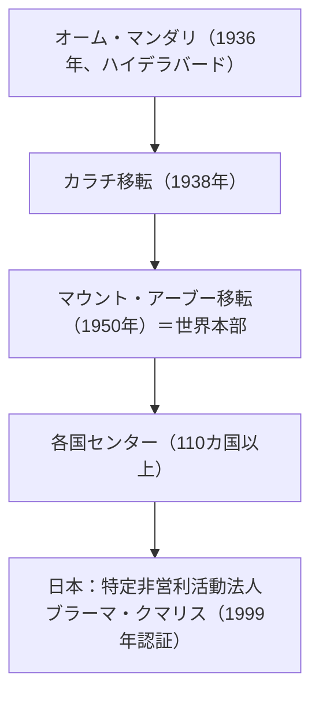

# ブラフマ・クマリス 専門構造分析ノート

> [!summary] 要旨
> ブラフマ・クマリス（Brahma Kumaris World Spiritual University）は、1936年に宝石商レクラジ・クリパラニ（ブラフマ・ババ、1876-1969）がシンドのハイデラバード（現パキスタン）で始めた「オーム・マンダリ」を起源とする、女性主導型の国際的霊性運動である。自己を肉体ではなく永遠の魂と自覚するラージャヨガ瞑想、最高魂（シヴァ）への帰依、純潔・菜食・白衣の生活規律、5,000年周期の世界史観を特徴とする。日本の組織は特定非営利活動法人ブラーマ・クマリス（法人番号9011205000387、東京都中野区上高田）であり、旧稿の「法人番号なし」は誤りだった（12節）。

---

## 1. 命題の構造（通説・正統本部 vs 本教団・自説）

ヒンドゥー教の改革運動として出発したが、最高魂シヴァの啓示を創始者が受けたとする独自の教義体系を持ち、既存のヒンドゥー教とも区別される新宗教として研究される。女性が運営の中心を担う点が組織的特徴である。

| 比較軸 | ブラフマ・クマリス | 備考 |
| :--- | :--- | :--- |
| 起源 | 1936年、オーム・マンダリ（ハイデラバード） | 英語版Wikipedia |
| 最高神 | 最高魂シヴァ（無形の光の点とされる） | 同上 |
| 世界史観 | 5,000年周期（黄金・銀・銅・鉄の4時代＋合流時代） | 同上 |
| 中核実践 | ラージャヨガ瞑想、毎日のムルリ学習 | 同上 |
| 生活規律 | 純潔（禁欲）、完全菜食、白い衣服 | 同上 |
| 日本法人 | 特定非営利活動法人ブラーマ・クマリス（認定NPO法人） | 国税庁・東京都 |

---

## 2. 基本情報

| 項目 | 内容 |
| :--- | :--- |
| **組織名称** | Brahma Kumaris World Spiritual University（ブラフマ・クマリス世界精神大学） |
| **創始者** | レクラジ・クリパラニ（ブラフマ・ババ、1876-1969） |
| **起源** | 1936年、ハイデラバード（シンド、現パキスタン）で「オーム・マンダリ」として発祥 |
| **世界本部** | インド・ラージャスターン州マウント・アーブー（Madhuban） |
| **日本法人** | 特定非営利活動法人ブラーマ・クマリス（法人番号 9011205000387） |
| **法人主たる事務所** | 東京都中野区上高田2丁目40番6号（国税庁登記、2020年6月1日に東中野より移転） |
| **NPO認証** | 1999年11月4日（東京都）。認定NPO法人として東京都に掲載（代表者：滝沢裕子） |
| **日本公式サイト** | https://brahmakumaris.jp/ |

---

## 3. 創始者と天啓・社伝

創始者レクラジ・クリパラニはシンドの裕福な宝石商で、1935年頃から一連の幻視・霊的体験を経験したとされ、最高魂シヴァが自らに降りて語ると説いた。彼を媒体とする神の言葉が「ムルリ」として日々語られ、共同体の学習の中核となった（英語版Wikipedia）。1930年代のシンドでは、女性のエンパワーメントを掲げたこの運動は論争を呼び、1938-39年には「オーム・マンダリ」が非合法団体とされる弾圧も受けた。

---

## 4. 沿革・歴史変遷

- 1936年：ハイデラバードでオーム・マンダリ発祥。
- 1938年：カラチへ移転。現地当局による活動禁止措置と法廷闘争（1938-39年）。
- 1950年：インド・マウント・アーブーへ移転し、世界本部となる。
- 1969年：ブラフマ・ババ死去。以後、女性指導者（ダーディー）を中心とする運営が続く。
- 1999年11月4日：日本の特定非営利活動法人ブラーマ・クマリスが認証（東京都）。
- 2020年6月1日：法人主たる事務所を中野区東中野1丁目4番4号から上高田2丁目40番6号へ移転（国税庁変更履歴）。
- 旧稿の「1970年代日本支部設立」は裏付けを確認できなかった（12節）。

---

## 5. 教理・儀礼・神観の深層解剖

### 5-1 神観と魂観
人間は肉体ではなく永遠の魂（アートマン）であり、最高魂（シヴァ）は無形の光の点として魂の世界（パラムダーム）に住すると説く。ラージャヨガ瞑想は、目を開けたまま行い、魂としての自己を自覚し最高魂を想起する実践である。

### 5-2 世界史観
歴史は5,000年の周期を繰り返すとされ、黄金時代・銀時代・銅時代・鉄時代の4時代と、現行の「合流時代」からなる。鉄時代の末に世界は変革期を迎え、新たな黄金時代が始まると説く（終末論的要素）。

### 5-3 生活規律とムルリ
純潔（結婚内を含む禁欲）、完全菜食（ラクター菜食）、白い衣服の着用が求められる。毎朝、各センターでムルリ（創始者を媒体として語られたとされる講話テキスト）の学習が行われる。

---

## 6. 宗教学的・歴史社会学的意義

女性が創始期から運営の中心を担う稀有な国際的新宗教であり、禁欲と女性の霊的権威を結びつけた点でジェンダーと宗教の研究対象となる。国連経済社会理事会との諮問資格を持つNGOとしても活動する。

---

## 7. 拠点・現地情報

- 世界本部：マウント・アーブー（インド・ラージャスターン州）。
- 日本法人の主たる事務所：東京都中野区上高田2丁目40番6号。
- 旧稿が「日本センター」とした目黒区五本木2丁目15-1は、本照合で確認できなかった（12節）。国内には神戸市灘区などにもセンターの所在が地図情報に見られるが、公式な一覧での確認は未了である。

---

## 8. 関連教団・関連人物・関連概念

- [[アートオブリビング]]（インド系国際霊性運動）
- [[超越瞑想（TM運動）]]（インド系瞑想運動）
- [[サティヤ・サイ・オーガニゼーション]]（インド系国際運動）

---

## 9. 史料・一次資料 (convMD)

- [[src_ブラフマ・クマリス_国税庁法人番号]]（法人番号9011205000387：名称・所在地・変更履歴）
- [[src_ブラフマ・クマリス_東京都NPO法人情報]]（東京都生活文化局：認証日・認定状態・代表者）
- [[src_ブラフマ・クマリス_Wikipedia]]（英語版Wikipedia「Brahma Kumaris」）

---

## 10. 参考文献・学術論文

- 英語版Wikipedia「Brahma Kumaris」「Raja Yoga Meditation (Brahma Kumaris)」（2026-11-15確認）
- 公式サイト brahmakumaris.jp は convMD・ブラウザ取得とも失敗したため未取得（12節）

---

## 11. 関連ノート (Vault内)

- [[_分派・異端研究ポータル]]

---

## 12. 留保（中立的併記・未確定要素）

> [!warning] 注意
> 1. **法人番号の訂正**：旧稿は法人番号を「なし」、社格を「任意団体 / 一般社団法人等」としていたが、国税庁で特定非営利活動法人ブラーマ・クマリス（9011205000387、検査用数字も整合）の実在を確認した。東京都生活文化局の情報では認証日1999年11月4日、認定NPO法人として掲載されている。
> 2. **所在地の訂正**：旧稿の日本センター所在地「目黒区五本木2丁目15-1」は、公式・公的資料のいずれでも確認できなかった。法人の登記上の主たる事務所は中野区上高田2丁目40番6号（2020年移転）である。五本木の住所は未検証として分離する。
> 3. **日本支部設立年**：旧稿の「1970年代日本支部設立」は裏付けを確認できなかった。確認できる日本の節目はNPO法人認証（1999年）である。
> 4. **信者数**：「世界100万人以上」は教団側の公称として併記する。国内信者数（旧稿「数百人〜数千人」）は出典未確認のため分離する。
> 5. **公式サイト未取得**：brahmakumaris.jp は convMD で変換できず、ブラウザ取得も失敗したため、公式サイト本文は未取得である。教義・沿革は英語版Wikipediaに基づく。
> 6. **幽霊典拠の付け替え**：旧稿が典拠とした `src_indian_hindu_movements` は `content/資料/` に実在しないため、実在する保存分（§9）へ付け替えた。
> 7. **改訂記録（2026-11-15・全件照合）**：旧稿の3セクション構成を宗教版12セクションへ再編。法人番号・法人格・所在地を公的資料で訂正し、evidence_type を official_database/5 から secondary_source_based/4 へ是正した。
> - evidence_type: secondary_source_based / confidence: 4

---

*※本稿は[[_分派・異端研究ポータル]]の個別教団分析ノートである。*
