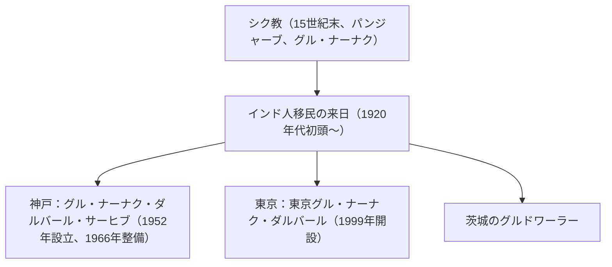

# 日本シク教共同体 専門構造分析ノート

> [!summary] 要旨
> 日本のシク教共同体は、1920年代初頭から日本に居住するパンジャーブ系インド人を中心とする小規模な宗教コミュニティである。神戸のグル・ナーナク・ダルバール・サーヒブは、1952年にグルドワーラー（礼拝堂）が設けられ、1966年に現在の形に整備された日本で最も古いグルドワーラーとされる。旧稿の「1932年建立」「北野町4丁目7-20」は誤り・未確認である（12節）。東京には1999年に東京グル・ナーナク・ダルバールが開設された。

---

## 1. 命題の構造（通説・正統本部 vs 本教団・自説）

シク教は新宗教ではなく15世紀末に成立した世界宗教であり、日本の共同体はインド人移民コミュニティの宗教施設として維持されている。本ノートは「日本のシク教共同体」の現況を扱う。

| 比較軸 | 神戸グルドワーラー | 東京グルドワーラー |
| :--- | :--- | :--- |
| 名称 | グル・ナーナク・ダルバール・サーヒブ | 東京グル・ナーナク・ダルバール |
| 設立 | 1952年（1966年に現在の形へ整備） | 1999年（カールサー生誕300年記念） |
| 所在地 | 神戸市中央区野崎通2-1-15 | 東京都文京区大塚3-5-4（ビルの地下） |
| 規模 | 長年日本で唯一のグルドワーラーだった | 信徒数約70人（2016年時点） |

---

## 2. 基本情報

| 項目 | 内容 |
| :--- | :--- |
| **宗教** | シク教（開祖：グル・ナーナク、1469-1539） |
| **聖典** | 『グル・グラント・サーヒブ』（永遠のグルとして扱われる聖典） |
| **本拠（聖地）** | ハルマンディル・サーヒブ（黄金寺院、インド・アムリトサル） |
| **日本の主な拠点** | 神戸（野崎通）、東京（文京区大塚）、茨城 |
| **日本の法人格・法人番号** | 未確認（東京のグルドワーラーはNPO法人グル・ナーナク・ダルバール東京が運営すると案内されるが、本照合では法人番号まで確認していない） |

---

## 3. 創始者と天啓・社伝

シク教はグル・ナーナク（1469-1539）がパンジャーブ地方で開いた一神教である。唯一神（イク・オンカール）への帰依、身分差別の否定、誠実な労働と分かち合い（セヴァー、無償奉仕）が説かれ、10代のグルを経て聖典『グル・グラント・サーヒブ』が永遠のグルと位置づけられた。

---

## 4. 沿革・歴史変遷

- 1920年代初頭：シク教徒のインド人が日本に住み始める。当初は横浜を拠点とし、1923年の関東大震災後に神戸へ移った。
- 1952年：神戸にグルドワーラーが設立される。
- 1966年：インド人移民の私邸群が土地購入・改修を経て本格的なグルドワーラー（グル・ナーナク・ダルバール・サーヒブ）となった（Wadhwa 2020、Routledge）。
- 1999年：東京グル・ナーナク・ダルバールがカールサー（共同体）生誕300年を記念して建立される。
- 旧稿の「1932年日本最古のグルドワーラー建立」は誤りである（12節）。

---

## 5. 教理・儀礼・神観の深層解剖

### 5-1 礼拝とランガル
グルドワーラーでは『グル・グラント・サーヒブ』の朗誦とキールタン（聖歌）が行われる。共食施設ランガルでは、信徒・訪問者を問わず無料の菜食の食事が提供される（平等と奉仕の実践）。

### 5-2 五つのK
正統なシク教徒は、ケーシュ（長髪）、カンガー（櫛）、カラー（鉄の腕輪）、キルパーン（短剣）、カッチェーラー（下衣）の「5つのK」を身につける。ターバンは長髪を覆うものである。

---

## 6. 宗教学的・歴史社会学的意義

日本のシク教は、貿易商として定着したインド人コミュニティの宗教的紐帯を示す事例であり、ランガルは在日外国人コミュニティの共食文化としても注目される。信徒数は小規模ながら、関西・関東に恒常的な礼拝拠点を持つ点で、移民宗教の定着形態の一例である。

---

## 7. 拠点・現地情報

- グル・ナーナク・ダルバール・サーヒブ：神戸市中央区野崎通2-1-15（〒651-0054）。三宮東側の住宅街に立地する（北野の異人館街ではない）。
- 東京グル・ナーナク・ダルバール：東京都文京区大塚3-5-4のビルの地下。礼拝は月次で案内される。
- 茨城県にもグルドワーラーが存在する。

---

## 8. 関連教団・関連人物・関連概念

- [[東京の宗教団体の子ども食堂・無料の食事一覧]]（ランガルの関連）
- [[ブラフマ・クマリス]]（インド系宗教）

---

## 9. 史料・一次資料 (convMD)

- [[src_日本シク教共同体_Wikipedia]]（英語版Wikipedia「Sikhism in Japan」）

---

## 10. 参考文献・学術論文

- 英語版Wikipedia「Sikhism in Japan」（2026-11-15確認。神戸グルドワーラーの1966年整備は Wadhwa 2020（Routledge）を出典とする）
- World Gurudwaras ディレクトリ（神戸・東京の所在地）

---

## 11. 関連ノート (Vault内)

- [[_分派・異端研究ポータル]]

---

## 12. 留保（中立的併記・未確定要素）

> [!warning] 注意
> 1. **建立年の訂正**：旧稿の「1932年日本最古のグルドワーラー建立」は誤りである。英語版Wikipedia（Wadhwa 2020に基づく）では、神戸のグルドワーラーは1952年に設立され、1966年に私邸から本格的なグルドワーラーへ整備されたとされる。
> 2. **所在地の訂正**：旧稿の「神戸市中央区北野町4丁目7-20」は確認できなかった。グルドワーラー案内（World Gurudwaras等）の住所は神戸市中央区野崎通2-1-15である。
> 3. **法人格・法人番号は未確認**：旧稿の社格「宗教法人 / 任意団体」は未検証のため分離する。東京の施設についてはNPO法人による運営が案内されるが、本照合では国税庁での個別確認まで行っていない。
> 4. **信者数**：旧稿の「世界2,600万人以上、国内数千人」のうち、国内数千人は出典未確認のため分離する。確認できる具体値は東京グルドワーラーの信徒数約70人（2016年時点、英語版Wikipedia）。
> 5. **幽霊典拠の付け替え**：旧稿が典拠とした `src_indian_hindu_movements` は `content/資料/` に実在しないため、実在する保存分（§9）へ付け替えた。
> 6. **改訂記録（2026-11-15・全件照合）**：旧稿の3セクション構成を宗教版12セクションへ再編。建立年・所在地の誤りを訂正し、evidence_type を official_database/5 から secondary_source_based/3 へ是正した。
> - evidence_type: secondary_source_based / confidence: 3

---

*※本稿は[[_分派・異端研究ポータル]]の個別教団分析ノートである。*
