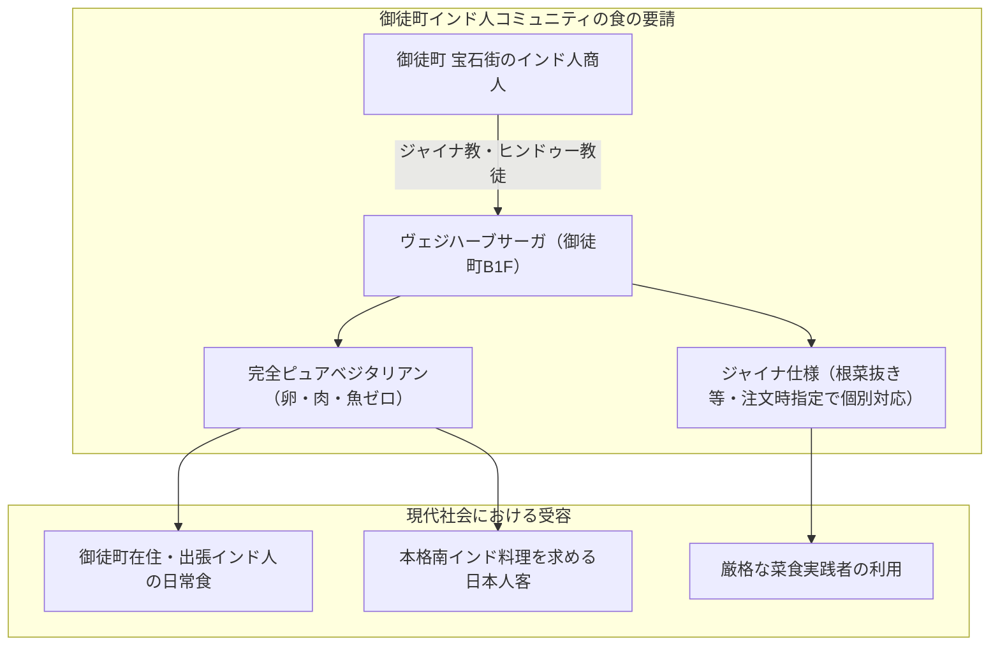

# ヴェジハーブサーガ（VEGE HERB SAGA）

> [!summary] 要旨
> **ヴェジハーブサーガ**は、東京都台東区上野（御徒町）に所在する完全菜食（ピュア・ベジタリアン）の南・北インド料理レストランである。2009年にジャイナ教徒の宝石商ラジェンドラ・ジェインが開業した。御徒町は宝石取引に従事するインド人（ジャイナ教徒が多い）が集まる地域であり、本店は彼らの食戒律に対応する日常の食卓として機能してきた。全メニューが肉・魚・卵不使用であり、注文時に指定すれば根菜類を除く「ジャイナ仕様」の調理にも個別に対応する。在日インド人コミュニティの宗教的ライフラインであると同時に、日本における宗教食対応の事例として位置づけられる。

---

## 1. 命題の構造（一般客 vs ジャイナ教・ヒンドゥー教戒律）

### 比較考察マトリクス表

| 比較軸 | 一般カレー愛好家・日本人客（etic） | ジャイナ教・厳格ヒンドゥー教徒（emic） |
| :--- | :--- | :--- |
| **料理の印象** | 玉ねぎやニンニクを使わなくてもスパイシーで美味しい | カルマ（業）を生まず、霊性を汚さない「純粋食（サトヴィック）」 |
| **根菜抜きの理由** | 匂いが残らない、胃もたれしない | アヒムサー（非暴力）の実践（収穫時に植物を死なせ、地中の生物を傷つけることを避ける） |
| **卵の扱い** | 卵くらいは入っていても良いのではという感覚 | 卵は生命の芽であり殺生と同等（厳禁） |
| **立地の意味** | 上野・御徒町の本格インド料理店 | 日本で信仰と日常を守れるコミュニティの食卓 |

---

## 2. 基本情報

| 項目 | 内容 |
| :--- | :--- |
| **店舗名** | ヴェジハーブサーガ（VEGE HERB SAGA） |
| **業態** | 完全菜食（ピュア・ベジタリアン）南北インド料理。ジャイナ仕様は注文時に個別対応 |
| **開業** | 2009年 |
| **オーナー** | ラジェンドラ・ジェイン（宝石卸商を兼業するジャイナ教徒） |
| **所在地** | 東京都台東区上野5-22-1 東鈴ビル B1F（〒110-0005） |
| **アクセス** | JR「御徒町駅」南口より徒歩約3分、東京メトロ日比谷線「仲御徒町駅」徒歩約3分 |
| **営業時間** | ランチ 11:15–14:30／ディナー 17:15–22:30、不定休（公式サイト記載、2026-11-15確認） |
| **電話** | 03-5818-4154 |
| **代表メニュー** | 南インド・ミールス、ドーサ、グジャラーティ・ターリー、パニール料理、チャパティ（店舗紹介記事・公式サイトによる） |

---

## 3. 起源と成立の経緯

- 御徒町周辺は「ジュエリータウン」と呼ばれ、1,000軒以上の宝石関連業者が集まる。インドは宝石加工の一大産業地であり、担い手にはジャイナ教徒が多い。御徒町で商うインド人宝石商の多くもジャイナ教徒である（『散歩の達人』の店舗紹介記事による）。
- 宝石商のラジェンドラ・ジェインは2009年に本店を開業した。同記事によれば、ジャイナ教徒にとって「これがジャイナ料理」という固定した料理体系があるわけではなく、さまざまなメニューをジャイナスタイル（根菜を入れない等の指定）で調理してくれる点が本店の特徴とされる。戒律の解釈は個人・家族によって異なり、シェフが個別の指定に応じているという。

---

## 4. 変遷・歴史

- 2009年の開業以降、御徒町のジャイナ教徒コミュニティの集う場として継続営業している。2026年4月号『散歩の達人』の店舗紹介記事でも現役の店舗として紹介されており、公式サイトも営業時間等を掲載している（2026-11-15確認）。
- 個別の年次的変遷（改装・メニュー改定等）は本照合の出典範囲では確認できていない（§12参照）。

---

## 5. 内容・様式の深層解剖

### 5-1. ジャイナ教のアヒムサー（不殺生）と食のタブー
ジャイナ教は厳格な不殺生主義（アヒムサー）を貫く宗教であり、食実践の一般原則として以下が知られる。
1. **動物性食材の拒絶**: 肉・魚・卵を避ける（乳製品は伝統的に許容される）。
2. **根菜類の回避**: タマネギ・ジャガイモ等の地中根菜は、収穫時に植物全体を死に至らしめ、土中の微生物を傷つけるため避けられる。また根菜は無数の微小生命が宿る「アナンタカーヤ（無数体）」とみなされる場合がある。
3. **夜間飲食の回避**: 日没後の飲食は、暗がりで小虫を誤飲する恐れがあるため避ける伝統がある。

なお、東アジアの仏教・道教に由来する「五葷（ネギ・ニンニク・ニラ等）」の禁忌は、ジャイナ教の根菜回避とは起源を異にする別系統の概念である。旧稿は両者を同一視していたが、本照合で分離した（§12）。

### 5-2. ノーオニオン・ノーガーリックでの味覚構築
五葷・根菜を使わないインド料理では、ヒング（アサフェティダ）、トマト、カシューナッツ、ココナッツ、各種スパイスのテンパリング等でコクを構築する手法が一般に用いられる。本店の具体的な調理手法の詳細は、本照合の出典（公式サイト・店舗紹介記事）では確認できていない。

---

## 6. 学術的・社会学的意義

- **日本におけるジャイナ食文化の拠点**: 御徒町の宝石取引コミュニティという具体的な移民・商業ネットワークの上に成立した宗教食対応の事例であり、宗教的アイデンティティの維持と外食インフラの関係を示す。
- **オリエンタルベジの東西比較**: 東アジアの「仏教・道教・一貫道の素食」と、南アジアの「ジャイナ・ヒンドゥーのサトヴィック食」は、いずれも不殺生を背景とするが、禁忌の対象（五葷 vs 根菜）と理論的根拠は異なる。両者を日本で対照できる拠点の一つである。

---

## 7. 拠点・現地情報

- 所在地・営業時間は§2の通り（公式サイト、2026-11-15確認）。営業時間・定休日は変更される場合があるため、利用時は公式サイト等で再確認されたい。
- 完全なジャイナ仕様を希望する場合は、注文時に「ジャイナスタイル（根菜抜き等）」と指定する必要がある（店舗紹介記事による）。

---

## 8. 関連対象・関連人物・関連概念

- **ジャイナ教（Jainism）**: マハーヴィーラを祖とする不殺生宗教
- **アヒムサー（Ahimsa）**: 非暴力・不殺生の徳目
- **サトヴィック（Sattvic）**: 心を清らかに保つ純質食（ヒンドゥー教・アーユルヴェーダ）
- **[[ゴヴィンダス（Govinda's）船堀店]]**: クリシュナ意識国際協会（ISKCON）系の五葷抜きインド料理
- **[[Veg Kitchen（ベジキッチン・仲御徒町）]]**: 近隣のジャイナ対応インド料理店
- **[[各教団の食の教義・タブー比較]]**: 宗教食・禁忌の総合比較

---

## 9. 史料・一次資料 (convMD)

- [[src_ヴェジハーブサーガ_公式サイト]] — 店舗公式サイト（所在地・営業時間・電話番号を確認）
- [[src_ヴェジハーブサーガ_散歩の達人]] — 『散歩の達人』店舗紹介記事（オーナー像・2009年開業・ジャイナスタイル対応の実態を確認）

---

## 10. 参考文献・学術論文

- 『散歩の達人』2026年4月号（店舗紹介記事。上記src_として保存）
- ジャイナ教の食戒律の一般論については、宗教学の概説書を参照されたい（個別書誌は§12の留保を参照）。

---

## 11. 関連ノート (Vault内)

- [[ゴヴィンダス（Govinda's）船堀店]]
- [[Veg Kitchen（ベジキッチン・仲御徒町）]]
- [[中一素食店（台湾素食レストラン）]]
- [[健福（台湾素食レストラン）]]
- [[菜食健美（大晶企画・道徳会館）]]
- [[香林坊（中野・台湾素食）]]
- [[一貫道と台湾素食レストラン]]
- [[各教団の食の教義・タブー比較]]
- [[バグワン・マハビールスワミ・ジェイン寺院（神戸ジャイナ寺院）]]

---

## 12. 留保（中立的併記・未確定要素）

> [!warning] 注意
> - **訂正（2026-11-15・全件照合）**: (1) 開業年を旧稿の「2010年代」から **2009年** に訂正（『散歩の達人』記事）。(2) オーナーを「在日インド人実業家・ジャイナ教/ヒンドゥー教徒コミュニティ」とする曖昧な記述から、宝石商でジャイナ教徒の **ラジェンドラ・ジェイン** と特定した。(3) 公式サイトURLを食べログから店舗公式サイト（vegeherbsaga.com）へ付け替えた。(4) 旧稿の「根菜抜き＝五葷抜き」という記述は、ジャイナ教の根菜回避と東アジアの五葷禁忌という別系統の概念の混同であるため分離・訂正した。(5) 「ジャイナ教対応メニュー常設」との表現は実態（全メニューピュアベジ＋ジャイナ仕様は注文時に個別対応）に合わせて修正した。(6) evidence_type の `primary_and_secondary_sources`（7値外）を `secondary_source_based` に、confidence を 5 から 3 に是正した。検証日を2026-11-15に更新した。
> - **未検証として分離した主張**: 旧稿出典欄の「インド大使館推薦情報」は確認できず採用しない。旧稿参考文献の河野亮仙『インドの宗教と食文化』、上田紀行『スリランカ・インドの仏教と社会』は本照合の検索範囲で書誌を確認できなかったため§10から外した（実在を否定するものではない）。本店のシェフの招聘経路、個別メニューの現行ラインナップ、ハラール認証の有無（口コミサイトに言及があるのみ）は未確認である。
> - **時点情報**: 営業時間・営業実態は2026-11-15時点の公式サイトおよび2026年4月の雑誌記事に基づく。
> - evidence_type: `secondary_source_based`、confidence: `3`

---

*※本稿は[[_分派・異端研究ポータル]]の飲食・食品関連およびインド宗教（ジャイナ教・ヒンドゥー教）食文化実践に関する専門ノートである。*
