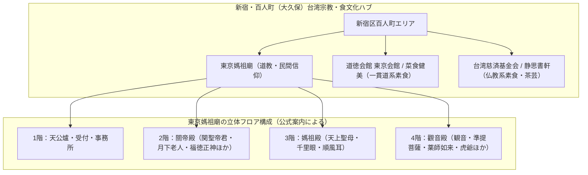

# 東京媽祖廟 専門構造分析ノート

> [!summary] 要旨
> **東京媽祖廟**は、東京都新宿区百人町（大久保・新大久保エリア）に2013年10月13日に開廟した4階建ての都市型台湾道教寺院である。海の守護女神・**天上聖母（媽祖）**を主神とし、日本媽祖会が中心となって計画・建立された（Wikipedia）。公式案内によれば、媽祖像は粉面媽祖（中国・湄洲、泉州天后宮の分霊）、黑面媽祖（台湾・北港朝天宮の分霊）、金面媽祖（台湾・南方澳南天宮の分霊）の三面が祀られる。新宿区百人町は、本廟から徒歩数分の範囲に「[[菜食健美（大晶企画・道徳会館）\|菜食健美（道徳会館東京会館）]]」や台湾仏教・慈済基金会の「[[静思書軒（Jing Si Books & Cafe）\|静思書軒]]」が集積しており、首都圏における台湾・中華系宗教・素食文化の一大ハブを形成している。旧版のフロア配置・分霊元の記述は公式案内と食い違っていたため、本版で訂正した（詳細は12節）。

---

## 1. 命題の構造（百人町台湾宗教圏における位置づけ）

### 比較考察マトリクス表（大久保台湾系施設群の対比）

| 比較軸 | 東京媽祖廟（百人町1丁目） | 菜食健美・道徳会館（百人町2丁目） | 静思書軒・慈済（百人町） |
| :--- | :--- | :--- | :--- |
| **宗教・思想系統** | **台湾伝統道教・民間信仰** | **一貫道師母組系新宗教（道徳会館）** | **台湾現代仏教（慈済基金会）** |
| **主神・本尊** | **天上聖母（媽祖）**、関帝、月下老人 | **弥勒仏**、観音、三宝 | **釈迦牟尼仏**、証厳法師の慈悲行 |
| **施設形態** | 4階建てビル式道廟 | 1階：レストラン / 上階：会館道場 | 仏教交流センター / 精進カフェ・茶芸 |
| **食の実践** | 祭礼時の供物、周辺素食店との連携 | **五葷抜き台湾素食（New精進料理）**の提供 | **静思香積麺**（乾麺）・オーガニック茶 |
| **機能** | 在日台湾人の祈願・心の拠り所・祭礼 | 信徒の菜食自給・一般客への結縁 | 慈善ボランティア・環境保護・国際救援 |

- 命題上の注意：旧版は本廟を「日本国内初の本格的な都市ビル型台湾道教寺院」と断定していたが、「国内初」を裏付ける出典は確認できなかった。確認できる範囲では「東京で唯一の媽祖廟」とされる（12節）。

---

## 2. 基本情報

| 項目 | 内容 |
| :--- | :--- |
| **廟名** | 東京媽祖廟（とうきょうまそびょう） |
| **運営法人** | 一般社団法人 日本媽祖会 ／ 東京媽祖廟 |
| **開廟年月日** | 2013年（平成25年）10月13日（安座式典） |
| **所在地** | 東京都新宿区百人町1-24-12 |
| **主神** | **天上聖母（媽祖）**（粉面媽祖＝湄洲・泉州天后宮、黑面媽祖＝北港朝天宮、金面媽祖＝南方澳南天宮の分霊。公式案内による） |
| **配祀神** | 関聖帝君、済公、武財神、月下老人、福徳正神、中壇大元帥、太歳星君、千里眼、順風耳、五營將軍、観音菩薩、準提菩薩、孔雀明王、薬師如来、地蔵王菩薩、虎爺 |
| **拝観・参拝** | 9:00〜17:30（地図サービス掲載情報。公式サイトでは未確認。12節参照） |
| **公式URL** | `http://www.maso.jp/` |

---

## 3. 創始者と天啓・社伝（建立の経緯）

### (1) 在日台湾人コミュニティの悲願
日本国内には横浜や神戸に関帝廟・媽祖廟が存在していたが、首都・東京に在住する台湾出身者や留学生にとって、日常的に参拝できる本格的な廟が存在しなかった。日本媽祖会が中心となって計画が進められ、JR大久保駅至近に建立された（Wikipedia）。

### (2) 台湾・中国からの分霊（公式案内による）
公式案内（maso.jp「東京媽祖廟のご案内」）によれば、3階媽祖殿には次の三面の媽祖が祀られる。
- **粉面媽祖**: 中国・湄洲、泉州天后宮の分霊
- **黑面媽祖**: 台湾・北港朝天宮の分霊
- **金面媽祖**: 台湾・南方澳南天宮の分霊

旧版が挙げていた「台南大天后宮、台湾護聖宮（ガラス廟）からの分霊」は公式案内に記載がなく、未検証として12節に分離した。建築装飾や神像を台湾の工芸師が制作したとする旧版の記述も、個別の出典は未確認である。

### (3) 多文化共生と都市型コミュニティ
大久保エリアは多国籍・多文化の街として知られ、本廟は台湾人のみならず多様な参拝者を受け入れる都市型の聖域として機能している。一般客の見学・参拝を受け付けていることはWikipediaでも確認できる。

---

## 4. 沿革・歴史変遷

| 年代 | 出来事 | 出典・備考 |
|---|---|---|
| 2013年10月13日 | **開廟（安座式典）** | Wikipedia（日本語版・英語版） |
| 現在 | 新宿区百人町の台湾系宗教・食文化クラスターの中核施設の一つとして運営 | Vault内関連ノートと整合 |

- 建立に至る計画・建設過程の詳細（土地取得年、建設費、設計者等）は、公的資料では確認できなかった。

---

## 5. 教理・儀礼・神観の深層解剖（境内構造とフロア別神仏配置）

公式案内（maso.jp）に基づくフロア構成は以下のとおりである。旧版の配置（1階に虎爺・福徳正神、4階に準胝観音のみ等）は公式案内と食い違うため訂正した。

- **1階：天公爐・受付・事務所**
  - 天公（玉皇上帝）への香炉、受付、事務所が置かれる。
- **2階：關帝殿**
  - **関聖帝君**を中心に、済公、武財神、**月下老人**（良縁・結婚）、**福徳正神**、中壇大元帥、太歳星君が祀られる。
- **3階：媽祖殿（正殿）**
  - 本廟の中心。粉面・黑面・金面の三面の**天上聖母（媽祖）**が鎮座し、脇侍として「千里眼（遠くの災難を見通す神）」と「順風耳（遠くの苦しみの声を聞き分ける神）」、五營將軍が配される。
- **4階：觀音殿**
  - **観音菩薩**、準提菩薩、孔雀明王、薬師如来、地蔵王菩薩、そして**虎爺**が祀られ、道教と仏教の習合が空間的に示されている。

- 祭祀実践：線香供養、ポエ占い、媽祖祭（神輿巡行）などの台湾式祭祀が行われるとされる。具体的な年中行事の日程は公式サイトの行事案内で確認を要する。

---

## 6. 宗教学的・歴史社会学的意義

- 東京媽祖廟は、横浜・神戸の港町型中華街廟とは異なり、多国籍化した首都の住宅・商業混在地区に立地する**都市ビル型の道廟**として、在日台湾人の信仰拠点の新しい形態を示す。
- 百人町における道徳会館（菜食健美）・慈済（静思書軒）との地理的集積は、教団組織としての直接関係はないものの、台湾系の宗教・食文化が一区画に集積した事例として文化人類学的な観察対象となる。

---

## 7. 拠点・現地情報

| 項目 | 内容 |
|---|---|
| 所在地 | 東京都新宿区百人町1-24-12 |
| アクセス | JR中央・総武線「大久保駅」南口より徒歩約1分、JR山手線「新大久保駅」より徒歩約5分、西武新宿線「西武新宿駅」北口より徒歩約5分 |
| 開廟時間 | 9:00〜17:30（地図サービス掲載情報。公式サイトでの確認は未了） |
| 近隣拠点 | [[菜食健美（大晶企画・道徳会館）]]（百人町2-21-26）、[[静思書軒（Jing Si Books & Cafe）]]（百人町・慈済東京分会） |

---

## 8. 関連教団・関連人物・関連概念

- **天上聖母（媽祖）**: 海洋守護・慈悲救済の女神
- **[[横浜関帝廟・横濱媽祖廟]]**: 横浜中華街の道教二大廟
- **[[五千頭の龍が昇る聖天宮]]**: 埼玉県坂戸市の台湾宮殿式道観
- **[[神戸関帝廟]]**: 関西の華僑道教廟
- **[[菜食健美（大晶企画・道徳会館）]]**: 近隣（百人町2丁目）の道徳会館系素食レストラン
- **[[静思書軒（Jing Si Books & Cafe）]]**: 近隣の慈済基金会系精進カフェ

---

## 9. 史料・一次資料 (convMD)

- [[src_東京媽祖廟_公式案内]]（公式サイト maso.jp「東京媽祖廟のご案内」。フロア構成・分霊元の一次根拠）
- [[src_東京媽祖廟_Wikipedia]]（Wikipedia「東京媽祖廟」。開廟日・所在地・日本媽祖会の関与の根拠。本文の一部は変換で欠落したため検索結果等と併せて照合）

---

## 10. 参考文献・学術論文

- 東京媽祖廟公式サイト `http://www.maso.jp/`（ご案内ページ）
- Wikipedia「東京媽祖廟」（日本語版・英語版）
- ※旧版が挙げていた「日本台湾学会『日本台湾学会報』所収論文」「新宿区地域文化財調査報告書」は、実在・該当記述を確認できなかったため12節に分離した。

---

## 11. 関連ノート (Vault内)

- [[菜食健美（大晶企画・道徳会館）]]
- [[静思書軒（Jing Si Books & Cafe）]]
- [[横浜関帝廟・横濱媽祖廟]]
- [[五千頭の龍が昇る聖天宮]]
- [[神戸関帝廟]]
- [[天道（一貫道）]]
- [[道徳会館]]
- [[一貫道と台湾素食レストラン]]

---

## 12. 留保（中立的併記・未確定要素）

> [!warning] 留保事項
> - **法人格**: 一般社団法人日本媽祖会による運営（Wikipedia）。法人番号そのものは本照合では確認していない。
> - **百人町台湾クラスター**: 菜食健美や静思書軒とは教団組織としての直接関係はないが、台湾系文化・食・信仰が百人町という地理的一区画に集積した文化人類学的共生関係にある。
> - 本ノートの evidence_type は `primary_source_based`、confidence は `4`（2026-11-15の全件照合で変更。理由は下記改訂記録参照）。

> [!note] 改訂記録（2026-11-15・全件照合）
> - **照合に用いた資料**: 東京媽祖廟公式サイト（maso.jp「ご案内」ページ）、Wikipedia「東京媽祖廟」（日本語版・英語版）、地図サービスの施設情報。公式案内とWikipediaは convMD で `資料/` に保存した。
> - **訂正1（フロア配置）**: 公式案内に基づき全面差し替え。主な相違：虎爺は1階ではなく**4階觀音殿**、福徳正神は1階ではなく**2階關帝殿**、1階は天公爐・受付・事務所、4階は観音・準提菩薩・孔雀明王・薬師如来・地蔵王菩薩・虎爺。
> - **訂正2（分霊元）**: 旧版「北港朝天宮・台南大天后宮・台湾護聖宮」→ 公式案内の **粉面媽祖＝湄洲・泉州天后宮、黑面媽祖＝北港朝天宮、金面媽祖＝南方澳南天宮** に訂正。
> - **訂正3（公式サイトURL）**: 旧版の tokyo-masobyo.jp は取得できず（convMD失敗）、Wikipediaが公式としてリンクする **maso.jp** に差し替えた。
> - **訂正4（配祀神）**: frontmatter・本文の配祀神を公式案内の祭神構成に合わせて更新した（済公・武財神・中壇大元帥・太歳星君・五營將軍・孔雀明王・薬師如来・地蔵王菩薩を追加）。
> - **未検証として分離した主張**: (1) 「日本国内初の本格的な都市ビル型台湾道教寺院」——「国内初」の出典なし（確認できるのは「東京で唯一の媽祖廟」とする紹介まで）。(2) 分霊元としての台南大天后宮・台湾護聖宮。(3) 参拝時間「9:00〜18:00・年中無休・入場無料」——公式サイトで確認できず、地図サービス掲載は9:00–17:30。本文は地図サービス掲載値を出典明記で記載し、確定値とはしない。(4) 信者数「年間数万人規模」。(5) 法人番号「確認済み」とする旧frontmatter——番号自体を確認していないため「未確認」に改めた。(6) 参考文献として挙げられていた日本台湾学会論文・新宿区報告書——実在未確認。(7) 建築装飾・神像を「すべて台湾の一流彫刻師・工芸師が制作」とする記述——個別出典なし。
> - **取得失敗の資料**: tokyo-masobyo.jp（convMDで変換失敗）。承認待ちサイトではなく技術的失敗のため「未取得」と記録する。
> - **evidence_type**: `primary_source_based` を維持（分霊・フロア構成という中核情報を公式一次資料で直接確認できたため。7値の範囲内）。
> - **confidence の変更**: `5` → `4`（中核情報は一次資料で確認できたが、参拝時間・信者数・法人番号等の未検証項目が残るため）。
> - **構造再編**: references/religion.md の宗教版12セクション構造へ再編した。旧1節（位置づけ・フロア図）→新1節・新5節、旧2節→新2節、旧3節→新3節、旧4節（境内構造）→新5節、旧5節→新8節、旧6節→新9節・新10節、旧7節→新11節、旧8節→新12節。現地情報は新7節に分離した。記述内容の削除は行っていない（未検証の主張は12節へ分離）。

---

*※本稿は[[_分派・異端研究ポータル]]の道教・都市型華僑宗教施設に関する専門構造分析ノートである。*
