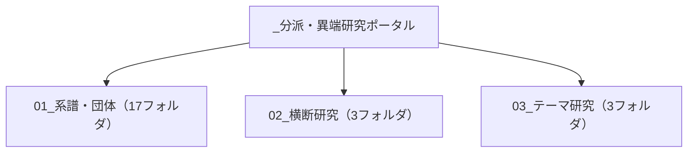

# _分派・異端研究ポータル (Tenrikyo Offshoots Research Portal)

> [!summary] ポータル概要と研究指針
> 本ポータルは、天理教（親里本部）から明治・大正・昭和・現代にかけて派生・分離・独立した分派教団・異端講社・史料批判研究派、創始者・天啓者、裁判・弾圧事件史、家系図、および全国・世界拠点・甘露台一覧に関する専門ノートを体系的に網羅・整理した中央研究統合ハブである。

> [!warning] 留保
> 各ノートのconfidence・evidence_type表記を鵜呑みにせず、出典URL・検証日フィールドを確認して活用すること。

---

## 1. 命題の構造（3軸分類の全体図）

2026-11-24のVault再構築（フェーズ3）により、本フォルダの本体ノートは「系譜・団体」「横断研究」「テーマ研究」の3軸に分離された。各軸・各フォルダの全ノート索引は§5に収録する。分類の判定基準と運用ルールは、本ノート末尾の「分類と運用ルール」（§13）を正文とする。

---

## 2. 基本情報

| 項目 | 内容 |
| :--- | :--- |
| **位置づけ** | 01_宗派・異端研究フォルダの中央ポータルハブ。2026-11-24の再構築で系譜・団体／横断研究／テーマ研究の3軸構成となり、全ノートの索引（§5）と分類・運用ルールの正文（§13）を収録する |
| **中核対象** | 天理教（奈良親里本部）の分派・異端・派生講社・裁判・家系図・史料・全国拠点 |
| **検証日** | 2026-11-15（全件照合。各個別ノートの検証日は当該ノート参照） |

---

## 3. 起源と成立の経緯

本ポータルは、本Vaultにおける天理教分派・異端研究ノートの蓄積を体系的に統合するために設けられた索引ノートである。当初は天理教系を中心に構成されたが、照合の過程で日本の主要新宗教全般・コミューン・食文化関連ノートへの横断索引を含む形に拡張された。

---

## 4. 変遷・歴史

- 2026-11-15の全件照合により、配下の個別ノートは一次資料・公的記録（国税庁法人番号・文化庁『宗教年鑑』等）との照合と宗教版12セクションへの再編を完了した。本ポータル側の数値・現状記述も同照合の確定情報に合わせて更新した（§12の改訂記録参照）。

- 2026-11-24のVault再構築（フェーズ1〜4）により、エビデンスはルートの`資料/`へ一本化され、本体ノートは系譜・団体／横断研究／テーマ研究の3軸構成へ再編された。本ポータルも§5を現行ツリーからの機械生成による全件索引へ更新し、末尾に分類と運用ルールの正文（§13）を新設した。

---

## 5. 内容・様式の深層解剖（全ノート索引）

本節は、2026-11-24時点の現行ツリーから機械生成した全件索引である。構成は「3軸 → フォルダ（件数） → ノート」の階層とし、`01_宗派・異端研究` 配下の本体ノート全件を網羅する（`sources/` 配下は対象外）。本ポータル自体は本フォルダ直下に置かれる索引ノートであり、下記の各フォルダには含まれない。各ノートの内容・検証水準は当該ノートの frontmatter と§12を確認すること。

### 5-1. 01_系譜・団体（270件）

#### 00_分類待ち（0件）

- （現在、該当ノートなし）

#### 01_天理教系（28件）

- [[_天理教ポータル]]
- [[おうかんみち]]
- [[おみち]]
- [[ほんぶしん]]
- [[ほんみち]]
- [[世界心道教]]
- [[世界心霊教]]
- [[八楽会教団]]
- [[大道の教]]
- [[大韓天理教]]
- [[天理三輪講]]
- [[天理教]]
- [[天理教山名大教会]]
- [[天理教愛町分教会]]
- [[天理教日本橋大教会]]
- [[天理教豊文教会]]
- [[天理教麹町大教会]]
- [[天理神之打開場所]]
- [[天真教真祐殿教会]]
- [[天輪王明誠教団]]
- [[太道教]]
- [[朝日神社]]
- [[甘露台霊理斯道会]]
- [[甘露台（浅野博・大観道系分派）]]
- [[神一条教]]
- [[陽気づくめ垂水教会]]
- [[陽気づくめ系単立離脱教会]]
- [[陽気づくめ練馬教会]]

#### 02_大本系（9件）

- [[三五教]]
- [[大本]]
- [[愛善苑]]
- [[日月神示]]
- [[明道会・惟神会]]
- [[生長の家]]
- [[神政龍神会]]
- [[神道天行居]]
- [[鎮魂帰神法]]

#### 03_世界救世教・真光系（35件）

- [[いづのめ教団]]
- [[みろく神教]]
- [[ス光]]
- [[ス光光波世界神団]]
- [[ミロクコミュニティ救世神教]]
- [[世界メシア教]]
- [[世界救世教]]
- [[世界救世教会]]
- [[世界救世教聖光教会]]
- [[世界救世教黎明教会]]
- [[世界真光文明教団]]
- [[主神正法会]]
- [[健富和協会]]
- [[クリスチャンヴィーガン]]
- [[光明みろく會]]
- [[天子の里]]
- [[岡田茂吉研究所]]
- [[岡田茂吉の自然農法]]
- [[崇教真光]]
- [[救いの光教団]]
- [[救世主教]]
- [[救世真教]]
- [[新健康協会]]
- [[東京黎明教会]]
- [[東方之光]]
- [[MOAインターナショナル]]
- [[浄霊]]
- [[浄霊医術普及会]]
- [[真光正法之會]]
- [[神幽現救世真光文明教団]]
- [[神慈秀明会]]
- [[神聖位山真光神団]]
- [[聖観音教会]]
- [[陽光子友乃会]]
- [[世界救世教系譜と聖典継承]]
- 世界救世教系譜（系譜ノート。ローカル作成済み・未反映のためリンクしない）

#### 04_教派神道十三派（12件）

- [[出雲大社教]]
- [[実行教]]
- [[御嶽教]]
- [[扶桑教]]
- [[神理教]]
- [[神習教]]
- [[神道修成派]]
- [[神道大成教]]
- [[神道大教]]
- [[禊教]]
- [[金光教]]
- [[黒住教]]

#### 05_法華・日蓮系（17件）

- [[佛所護念会教団]]
- [[創価学会]]
- [[国柱会]]
- [[大乗教]]
- [[大慧會教団]]
- [[妙智會教団]]
- [[希心会]]
- [[平等大慧会]]
- [[思親会]]
- [[日蓮正宗]]
- [[普明会教団]]
- [[本門佛立宗]]
- [[正信会]]
- [[法華宗（本門流）]]
- [[立正佼成会]]
- [[霊友会]]
- [[顕正会]]

#### 06_キリスト教系・異端（18件）

- [[いのちの木メシアニック集会]]
- [[イエスの方舟]]
- [[イエス之御霊教会教団]]
- [[エホバの証人]]
- [[キリストの幕屋]]
- [[グッドニュース宣教会]]
- [[セブンスデー・アドベンチスト教会]]
- [[ファミリー・インターナショナル]]
- [[ヨハン東京キリスト教会]]
- [[万民中央教会]]
- [[世界平和統一家庭連合]]
- [[全能神教会（東方閃電）]]
- [[命の御言葉宣教会]]
- [[摂理（キリスト教福音宣教会・JMS）]]
- [[新天地イエス教]]
- [[早稲田奉仕園]]
- [[末日聖徒イエス・キリスト教会]]
- [[聖神中央教会]]

#### 07_手かざし・霊能・心霊系（13件）

- [[アースハート]]
- [[サイエントロジー]]
- [[スミレ会]]
- [[トゥルース教]]
- [[ワールドメイト]]
- [[友愛グループ女神ノ海]]
- [[天真道教団（飯島秀行）]]
- [[日本心霊科学協会]]
- [[日本敬神崇祖自修団]]
- [[白光真宏会]]
- [[神智学協会]]
- [[神霊感応学会]]
- [[霊波之光]]

#### 08_神道系（56件）

- [[いじゅん]]
- [[ひのもと]]
- [[まことの家]]
- [[一元の宮]]
- [[不二阿祖山太神宮]]
- [[丸山教]]
- [[円応教]]
- [[千手会]]
- [[古神道仙法教]]
- [[善隣教]]
- [[大和教団]]
- [[大和教（やまと）]]
- [[大宇宙教]]
- [[大真協会]]
- [[大祖教]]
- [[大聖会]]
- [[大自然界]]
- [[天地教]]
- [[天徳舎]]
- [[天心聖教]]
- [[天心道教団本庁]]
- [[天正啓示教会]]
- [[天照教]]
- [[天照皇大神宮教]]
- [[天祖光教]]
- [[天神の命心導会]]
- [[天神人祖一神宮]]
- [[天神教本庁]]
- [[宇宙の宮]]
- [[宇宙大元霊天照太陽教団救世実行道]]
- [[宇宙神教光明神]]
- [[宇宙神道惟神道産土会]]
- [[富士和教会]]
- [[日本神霊学研究会]]
- [[日本聖道教団]]
- [[月日教おうかんみち教会本部]]
- [[木曽御嶽本教]]
- [[松緑神道大和山]]
- [[璽宇]]
- [[生天光神明宮]]
- [[皇教本院派]]
- [[皇祖皇太神宮天津教]]
- [[石鎚本教]]
- [[石鎚神霊本教]]
- [[神命愛心会]]
- [[神国教]]
- [[神奈我良]]
- [[神道日之教]]
- [[神道日垣の庭]]
- [[神道真和教]]
- [[神霊教]]
- [[紀元会]]
- [[練真道教団]]
- [[聖神教]]
- [[荒薙教]]
- [[誠成公倫]]

#### 09_仏教系（16件）

- [[かむながらのみち]]
- [[不動宗]]
- [[中山身語正宗]]
- [[光明念佛身語聖宗]]
- [[六水院]]
- [[卍教団]]
- [[孝道教団]]
- [[念法眞教]]
- [[浄土真宗親鸞会]]
- [[真如苑]]
- [[解脱会]]
- [[身言正宗]]
- [[辯天宗]]
- [[阿含宗]]
- [[阿吽阿教団]]
- [[鞍馬弘教]]

#### 10_ユダヤ教系（3件）

- [[Chabad House of Japan]]
- [[Chabad Lubavitch of Japan Tokyo]]
- [[JCC Japan]]

#### 11_ヒンドゥー系（9件）

- [[Osho（ラジニーシ運動）]]
- [[アートオブリビング]]
- [[クリシュナ意識国際協会]]
- [[サティヤ・サイ・オーガニゼーション]]
- [[ブラフマ・クマリス]]
- [[マータ・アムリターナンダマイー（アンマ）]]
- [[日本シク教共同体]]
- [[日本ヴェーダーンタ協会]]
- [[超越瞑想（TM運動）]]

#### 12_道教系（7件）

- [[五千頭の龍が昇る聖天宮]]
- [[天道（一貫道）]]
- [[日本道観（道家道学院）]]
- [[東京媽祖廟]]
- [[横浜関帝廟・横濱媽祖廟]]
- [[神戸関帝廟]]
- [[道徳会館]]

#### 13_単立・諸系譜（23件）

- [[キク営界教団]]
- [[スコーレ家庭教育振興協会]]
- [[バハイ教]]
- [[パーフェクトリバティー教団]]
- [[モラロジー]]
- [[ライフスペース]]
- [[レムリア・ルネッサンス]]
- [[互尊伸哲学道教団]]
- [[修養団捧誠会]]
- [[光の友の会]]
- [[国際ラエリアン・ムーブメント]]
- [[大山ねずの命神示教会]]
- [[天真道教団]]
- [[天音ノ珠]]
- [[太陽を信じるピラミッドの会]]
- [[宇宙念波研究会]]
- [[心法会]]
- [[日本平和神軍]]
- [[椰子の実教団]]
- [[法の華三法行]]
- [[真生会]]
- [[神世界]]
- [[聖親聖基・聖馨香園]]

#### 14_フリーメイソン（16件）

- [[フリーメイソン]]
- [[天空ロッジ]]
- [[ソレイユ・ルヴァン]]
- [[日本の洪門]]
- [[フリーメイソン用語集]]
- [[フリーメイソンの乾杯と符丁]]
- [[ダンカン儀式書]]
- [[ダンカン儀式書_全訳]]
- [[モーガン暴露本]]
- [[モーガン暴露本_全訳]]
- [[アンダーソン憲章]]
- [[イルミナティ]]
- [[非正規・自称フリーメイソン団体]]
- [[ラウタロ・ロッジ網]]
- [[フリーメイソンと独立運動]]
- [[フリーメイソンの起源と分派]]

#### 15_オウム真理教系（5件）

- [[Aleph]]
- [[ひかりの輪]]
- [[オウム真理教]]
- [[ケロヨンクラブ]]
- [[山田らの集団]]

#### 16_GLA・高橋信次系（3件）

- [[GLA]]
- [[パナウェーブ研究所（千乃正法会）]]
- [[幸福の科学]]

### 5-2. 02_横断研究（98件）

#### 01_人物（43件）

- [[下ヨシ子]]
- [[中山みき]]
- [[中山家系図]]
- [[中山正善]]
- [[中野与之助]]
- [[井出国子]]
- [[会田ヒデ]]
- [[八島英雄]]
- [[出口なお]]
- [[出口王仁三郎]]
- [[友清歓真]]
- [[大西愛治郎]]
- [[大西玉]]
- [[天理教主要幹部家系図]]
- [[奥原基玄]]
- [[安丸姫]]
- [[岡田よし]]
- [[岡田マミ]]
- [[岡田光玉]]
- [[岡田家系図]]
- [[岡田斎]]
- [[岡田真明]]
- [[岡田茂吉]]
- [[岡田陽一]]
- [[岡重英]]
- [[岸一太]]
- [[戸田よき]]
- [[浅野和三郎]]
- [[深田千代子]]
- [[渡邉政男]]
- [[田中治吾平]]
- [[田村霊祥]]
- [[白川資長]]
- [[真木応瑞]]
- [[矢野祐太郎]]
- [[藤沢正教]]
- [[藤田妃見子]]
- [[谷口雅春]]
- [[関根豊松]]
- [[飯降伊蔵]]
- [[高井家系図]]
- [[魚住正信]]
- [[麻原彰晃]]

#### 02_概念・原典・事件・拠点（33件）

- [[MIHO MUSEUM]]
- [[MOA美術館と岡田茂吉ゆかりの美術館群]]
- [[おさしづ]]
- [[おさづけ]]
- [[おぢば]]
- [[おぢばがえりと親里詰所建築群]]
- [[おふでさき]]
- [[みかぐらうた]]
- [[イエスの方舟事件]]
- [[グロービートジャパン対平和神軍観察会事件]]
- [[バグワン・マハビールスワミ・ジェイン寺院（神戸ジャイナ寺院）]]
- [[レイキ（霊気）]]
- [[三軒三棟]]
- [[光ミュージアム]]
- [[八島英雄と中山みき研究ノート]]
- [[八島英雄の中山みき研究ノート（異説内容要約）]]
- [[団体参拝]]
- [[天理大学附属天理参考館]]
- [[天理教のおたすけ・おさづけと近代病気救済史]]
- [[天理研究会事件]]
- [[宗教都市天理の誕生と神殿建築]]
- [[手かざし]]
- [[明治15年甘露台石没収事件]]
- [[明治の教難と教派神道独立]]
- [[明治の教難と教祖牢くぐり]]
- [[東京富士美術館]]
- [[東京療院]]
- [[櫟本分署跡保存会]]
- [[泥海初め]]
- [[浄霊センター]]
- [[甘露台]]
- [[稿本天理教教祖伝]]
- [[陽気ぐらしと天理教の社会福祉・医療]]

#### 03_比較・史論・ハブ（22件）

- [[いづのめ教団_浄霊センター一覧]]
- [[ほんみちの隠れ拠点と宝場構造]]
- [[ほんみち全国宝場と詳細交通アクセス案内]]
- [[世界救世教系の商業・文化施設一覧]]
- [[伝統仏教系の寺カフェ・宿坊一覧]]
- [[各教団の食の教義・タブー比較]]
- [[大本系諸派の教義比較マトリクス]]
- [[天理教の分裂の系譜]]
- [[天理教の海外拠点と世界伝道網]]
- [[天理教分派・異端教団一覧]]
- [[天理教弾圧の構造と歴史要因]]
- [[天理教系の商業・文化施設一覧]]
- [[天理教系諸派の教義比較マトリクス]]
- [[奈良以外の甘露台と異端甘露台一覧]]
- [[手かざし系諸派の教義比較マトリクス]]
- [[日本近代新宗教におけるキリスト教習合の系譜]]
- [[東京・関東周辺の天理教系分派]]
- [[系統別分類カタログ]]
- [[関東の甘露台]]
- [[関東の甘露台と奉斎拠点一覧]]
- [[陽気づくめ教会拠点一覧]]
- [[革新天理教運動と昭和の教義論争]]

### 5-3. 03_テーマ研究（89件）

#### 01_飲食・食品関連（58件）

- [[BazaarCafe（バザールカフェ）]]
- [[CAFÉ きょうぶんかん]]
- [[Chana's Place]]
- [[Chick-fil-A（チックフィレイ）]]
- [[David's Deli]]
- [[EM菌]]
- [[GINZA BOOK CAFE・SHIBUYA BOOK CAFE（幸福の科学）]]
- [[Greens Restaurant（サンフランシスコ禅センター）]]
- [[In-N-Out Burger（イン・アンド・アウト）]]
- [[Loving Hut（ラビングハット）]]
- [[MIHO MUSEUM レストラン「ピーチ」（秀明自然農法）]]
- [[OH BHAIYA!（西葛西・ジャイナ対応ストリートフード）]]
- [[PL病院 カフェレストラン（パーフェクト リバティー教団）]]
- [[SUZU COFFEE（東京黎明アートルーム・自然農法カフェ）]]
- [[The Yellow Deli（イエローデリ）京都太秦店]]
- [[Veg Kitchen（ベジキッチン・仲御徒町）]]
- [[cafe Living Room 61]]
- [[うまかろう安かろう亭（オウム真理教飲食事業）]]
- [[こどもおぢばがえりと天理カレー]]
- [[しんとうざん茶店と大元なべ（黒住教・神道山）]]
- [[びっくりドンキーと生長の家（風説の検証）]]
- [[クリスチャンヴィーガン食]]
- [[ゴヴィンダス（Govinda's）船堀店]]
- [[サンパオリーノ]]
- [[ナタラジ（NATARAJ・自然派インド料理）]]
- [[ヤマギシの店・自然食直売所]]
- [[レストラン明世・MeiseiCafe]]
- [[ロシア正教会駐日ポドヴォリエ（本駒込・トラペザと聖ソフィヤ修道院）]]
- [[ヴェジハーブサーガ（VEGE HERB SAGA）]]
- [[一和（イルファ）とメッコール]]
- [[一如社・精舎食堂カフェ（真如苑）]]
- [[一貫道と台湾素食レストラン]]
- [[三育フーズとSDA菜食レストラン]]
- [[中一素食店（台湾素食レストラン）]]
- [[佛光山「滴水坊」法水寺店]]
- [[信濃町の飲食文化と池田大作（創価学会・風説の検証）]]
- [[健福（台湾素食レストラン）]]
- [[円応社食堂]]
- [[十八羅かん（念佛宗・佛教之王堂門前）]]
- [[咲璽季（台湾素食・オリエンタルヴィーガン）]]
- [[大聖堂食堂（立正佼成会・立花産業）]]
- [[大阪ハラールレストラン（大阪マスジド）]]
- [[実身美（サンミ）]]
- [[寺カフェ 茶庭（萬福寺）]]
- [[当別トラピスト修道院の製酪・直営売店]]
- [[救援派（クウォンパ）の有機農園・食品事業]]
- [[新天地の偽装カフェ（スタディカフェ・布教フロント）]]
- [[日光オリーブの里]]
- [[東京の公園の炊き出し一覧（宗教団体・市民団体）]]
- [[東京の宗教団体の子ども食堂・無料の食事一覧]]
- [[東京ジャーミイ トルコカフェ＆ハラールマーケット]]
- [[生長の家オープン食堂]]
- [[自然農法（岡田茂吉）]]
- [[苓々菜館・Veggie House（台湾素食）]]
- [[菜食健美（大晶企画・道徳会館）]]
- [[萬福寺の普茶料理]]
- [[静思書軒（Jing Si Books & Cafe）]]
- [[香林坊（中野・台湾素食）]]

#### 02_コミューン・共同体・エコビレッジ（9件）

- [[アズワン鈴鹿コミュニティ]]
- [[ジー・オー・ピー]]
- [[一燈園]]
- [[三角エコビレッジサイハテ]]
- [[安曇野シャンティクティ]]
- [[幸福会ヤマギシ会]]
- [[新しき村]]
- [[木の花ファミリー]]
- [[浮遊街]]

#### 03_宿泊関連（22件）

- [[延暦寺会館]]
- [[神宮会館]]
- [[聞法会館]]
- [[和順会館]]
- [[花園会館]]
- [[永平寺 親禅の宿 柏樹関]]
- [[ルーテル市ヶ谷ステイ（ルーテルの宿）]]
- [[愛光会館（大山ねずの命神示教会・神総本部）]]
- [[高野山宿坊群]]
- [[善光寺宿坊群]]
- [[羽黒山・手向宿坊街]]
- [[戸隠宿坊群]]
- [[御岳山宿坊群]]
- [[身延山宿坊群]]
- [[恐山宿坊「吉祥閣」]]
- [[天理教「詰所」]]
- [[生長の家宇治別格本山・新練成道場]]
- [[幸福の科学「精舎・正心館」]]
- [[カトリックの黙想の家]]
- [[大本・梅松苑「松香館」]]
- [[和空シリーズ（宿坊型ホテル）]]
- [[成田山新勝寺「参籠修行」]]

---

## 6. 学術的・社会学的意義

本ポータルは、天理教系の分派形成を中心に、日本の新宗教の分裂・独立・習合の諸相を単一の索引体系で横断できるようにした研究基盤である。各個別ノートは2026-11-15の全件照合で一次資料・公的記録との照合を経ており、本ポータルはその確定情報への入口として機能する。数値・現状記述は個別ノートの照合結果に合わせて随時更新される（§12の改訂記録参照）。

---

## 7. 拠点・現地情報（全主要拠点 交通アクセス・座標データベース／要再検証項目あり）

- **天理教本部**: 奈良県天理市三島町1番地1（34.5985, 135.8350。所在地表記は照合済み[[天理教]]ノートに合わせた。旧稿の「三島町271」は地番表示変更前の表記）
- **ほんみち高石本部**: 大阪府高石市羽衣3丁目1番72号（座標は要再検証）
- **ほんぶしん本部**: 岡山県岡山市東区神崎町1（〒704-8138）
- **日本聖道教団本宮**: 埼玉県さいたま市緑区芝原1丁目32-6（35.8820, 139.6975、聖魂殿・聖の森・神殿）
- **東京黎明アートルーム・SUZU COFFEE**: 東京都中野区東中野2丁目10-13（35.7037, 139.6868、岡田茂吉遺墨・東洋古美術・自然農法カフェ。なお東中野2丁目8-20は教会側施設の所在地であり、アートルームの所在地ではない）
- **陽気づくめ垂水教会**: 兵庫県神戸市垂水区名谷町1521（34.6596, 135.0694）
- **太道教本部**: 東京都杉並区阿佐谷南1-1-38（35.698706, 139.643295、座標確認済み・創始者は中村しげ）
- **甘露台霊理斯道会**: 栃木県大田原市「皇和大親宮」に移転済みとみられる（座標36.1296012, 139.9131561は旧・茨城県拠点のものである可能性が高く要再検証。創始者は斎藤年男、2026-07-27再確認）
- 「おやのみち甘露台」: **削除済み（2026-07-27、実在の裏付けが最終的に得られなかったため）**。
- **世界心道教**: 愛知県豊川市諏訪2丁目101番地（34.8236, 137.3752、創始者は会田ヒデ）

---

## 8. 関連対象・関連人物・関連概念

### 関連教団・関連人物・関連概念ネットワーク

### 関連教団
- [[天理教]]
- [[ほんぶしん]]
- [[陽気づくめ垂水教会]]
- [[陽気づくめ系単立離脱教会]]
- [[陽気づくめ教会拠点一覧]]
- [[太道教]]
- [[甘露台霊理斯道会]]
- [[八島英雄]]
- [[天理三輪講]]

---

---

## 9. 史料・一次資料 (convMD)

- 神戸垂水史料アーカイブ: `http://www.yousun.sakura.ne.jp/public_html/siryou2/kanrodai/kanrodai3.html`
- 最判平成18年1月20日判決（民集60巻1号1頁、第二小法廷）関連資料
- src_wikipedia_tenrikyo_honbun：Wikipedia「天理教」記事本文（教義・沿革・組織・教団への指摘。八島英雄の経歴の決定的裏付けを含む）
- [[src_日本聖道教団_note現地記録]]：note「日本聖道教団本宮に行った話｜アンモの目」（さいたま市緑区芝原の本宮・聖魂殿ピラミッド・聖の森現地調査および教団著作・教理の一次記録）の保存ファイル。旧稿が参照していた `src_note_nihonseidokyodan_honmiya` というファイル名は content/資料/ に実在しない幽霊典拠であったため、本ファイルへ付け替えた。
- `sources/`フォルダ内の`src_*`ファイル群。ただし`src_yashima_ichinomoto`・`src_kakushin_tenri`・`src_meiji19_himetsutatsu`・`src_doroumi_hajime`・`src_ofudesaki_select`・`src_osashizu_select`の6件は具体的引用文が実在未確認のため`evidence_type: primary_source_based`に無害化済み（各ファイル参照）。

---

## 10. 参考文献・公的記録・学術論文

- 文化庁編『宗教年鑑』
- 弓山達也『天啓のゆくえ—宗教が分派するとき』（日本地域社会研究所、2005年）
- 井上順孝 ほか編『新宗教教団・人物事典』（弘文堂、1996年）
- 松井圭介「カリスマの継承からみた天理教系教団の分派形成」人文地理学研究XXIV, 2000年

---

## 11. 関連ノート (Vault内)

- [[系統別分類カタログ]]（本ポータルの機能別分類を補完する、系統別の横断索引）
- [[天理教分派・異端教団一覧]]
- [[八島英雄]]
- [[陽気づくめ垂水教会]]
- [[陽気づくめ系単立離脱教会]]
- [[陽気づくめ教会拠点一覧]]
- [[天理三輪講]]
- [[奈良以外の甘露台と異端甘露台一覧]]
- [[天理教愛町分教会]]

---

## 12. 留保（中立的併記・未確定要素）

> [!important] 研究規範・客観性の徹底
> - 各ノートのconfidence・evidence_type・出典URL・検証日フィールドを確認して活用すること。
> - 一次情報の確認できない伝聞・俗説は「未確認」と明記し、曖昧な推測記述を排除する方針を継続する。

> [!warning] 注意
> - **改訂記録（2026-11-15・全件照合）**: ハブノートとして宗教版12セクションへ再編し、検証日の明示と未検証分離を徹底した。frontmatter の evidence_type `primary_source_based`（ポータル自体は一次資料ではないため過大）を `mixed_secondary_unverified` に正規化し、confidence を 4 から 3 に再評価した。個別項目の訂正は以下の通り（いずれも照合済み個別ノートの確定情報に基づく）。
>   1. **世界平和統一家庭連合の現状**: 旧稿の「2023年文科省より解散命令請求審理中」は陳腐化。2025年3月25日東京地裁の解散命令決定、2026年6月22日最高裁での確定・清算法人への移行に更新した。
>   2. **救世主教の創始地**: 旧稿の「名古屋」は誤り。照合済みノートにより大分県別府市（ただし単一二次資料由来・未検証）と訂正した。
>   3. **信者数の更新**: 佛所護念会教団「約111万人」→923,811人（『宗教年鑑 令和6年版』p.78）、霊友会「約127万人」→公称2,527,457人／年鑑国内1,053,203人（同p.77）、立正佼成会「約272万人」→1,801,218人（2023年12月31日現在）、顕正会「公称230万人」→公称約270万人。
>   4. **「公式サイトは確認できない」一括記述の訂正**: 19団体の一括記述について、天神人祖一神宮（Wix上の公式サイト）・日本神霊学研究会（nisshinkai.net）は公式サイトの存在が照合で判明しているため、例外として明記した。
>   5. **幽霊典拠の除去**: §9の `src_note_nihonseidokyodan_honmiya` は content/資料/ に実在しないファイル名であったため、実在する [[src_日本聖道教団_note現地記録]] へ付け替えた。
>   6. **天理三輪講**: 旧稿の「1931年・天理教から直接独立」を、学術二次資料が支持する1933年・ほんみち起源へ訂正し、旧説は出典不明の異説として分離した。
>   7. **東京黎明教会**: 旧稿の「長島すゞ子が独立」を、照合済みノート（1985年11月8日に東京支部が単立独立登記）へ合わせて訂正した。
>   8. **幸福会ヤマギシ会**: 旧稿の「東京都町田市に本部」を訂正。町田市忠生は東京案内所の所在地であり、単一の本部所在地は確定できない。最大拠点は豊里実顕地（三重県津市）。
>   9. **ジー・オー・ピー**: 旧稿は実在を前提に記述していたが、照合で実在を確認できなかったため、未検証である旨を明記した。
>   10. **おうかんみち**: 旧稿の「1946年に江上寿胤がおうかんみちを立教」を「1946年に再興、1960年に改称」へ精緻化した。
>   11. **光ミュージアムの運営法人名**: 旧稿の「一般財団法人光記念館」を現行の「一般財団法人光ミュージアム（旧・光記念館）」へ更新した。
>   12. **天理教本部の所在地**: frontmatter・§7の「〒632-8686 天理市三島町271」を、照合済み[[天理教]]ノートの「〒632-8501 天理市三島町1番地1」へ合わせた。ただし郵便番号632-8501自体は第7波の照合でも未確定とされており、確定値としては扱わない。
>   13. **天理教の信者数（追補・2026-11-16）**: §5-2bの「約120万人」を、照合済み[[天理教]]ノートの値（1,122,790人、文化庁『宗教年鑑』令和6年版、同ノートでWikipedia経由確認・年鑑原典は未取得）へ更新した。
> - **神道日之教について**: 本ポータルには神道日之教への言及は存在しなかった（点検済み）。同教団自体は照合済み[[神道日之教]]ノートで実在未確認（evidence_type: unverified）とされている。
> - 本ポータルの evidence_type は `mixed_secondary_unverified`、confidence は `3`（配下ノートの検証水準が一様でなく、本ポータル自体の記述も個別ノートへの依存度が高いため）。
> - **改訂記録（2026-11-21・波及判断9件目・本人決定）**: §7の「東京黎明アートルーム・SUZU COFFEE」の所在地を、第63件（2026-11-19・本人判断）の確定内容に合わせて修正した。旧表記「東中野2丁目8-20 / 2-10-13」の併記を改め、アートルーム／SUZU COFFEE の所在地は2-10-13（アートルーム公式サイト表示）であり、2-8-20は教会側施設の所在地である旨を明記した（本体ノート[[SUZU COFFEE（東京黎明アートルーム・自然農法カフェ）]]・[[東京黎明教会]]の確定表記と一致）。
>   - **改訂記録（2026-11-24・再構築フェーズ4）**: §1の分類図を3軸構成に合わせて更新し、§5を現行ツリーから機械生成した全件索引（3軸・19フォルダ・本体ノート419件）に書き換えた。あわせて末尾に「分類と運用ルール」（§13）を新設し、エビデンスの置き場、新規ノートの行き先判定、系譜フォルダの新設基準等の運用規約の正文を収録した。なお世界救世教系譜ノートはローカル作成済み・未反映のため、§5では wikilink にせず文章での言及にとどめた。

---

## 13. 分類と運用ルール

本節は、本Vault（religion-vault）のノート配置に関する運用規約の正文である（2026-11-24・再構築フェーズ4で制定）。

### 13-1. エビデンスの置き場

- エビデンス（一次資料の MD）はルートの `資料/` に一本化する。
- `sources/` は画像専用とし、MD を置かない。
- 公的機関の名簿・公表資料は `資料/公的資料/` へ入れる。
- Web クリッピング（web_clip）は原則として `資料/` へ入れ、専門ノート化したものだけ本体フォルダへ置く。

### 13-2. 新規ノートの行き先判定

1. 系譜・団体が明確なノート → `01_宗派・異端研究/01_系譜・団体/` の該当フォルダ。
2. 人物・概念・原典・事件・施設が主題のノート → `01_宗派・異端研究/02_横断研究/` の該当フォルダ。
3. 食・共同体などのテーマ横断のノート → `01_宗派・異端研究/03_テーマ研究/` の該当フォルダ。
4. 独立した系譜の団体 → `01_宗派・異端研究/01_系譜・団体/13_単立・諸系譜/`。
5. どうしても判定できない場合のみ `01_宗派・異端研究/01_系譜・団体/00_分類待ち/` とする。分類待ちに滞留させず、関連ノートがたまった時点で再判定する。

### 13-3. 系譜フォルダの新設基準

- `13_単立・諸系譜/` 内に同一系譜のノートが複数たまったら、独立フォルダへの切り出しを検討する。

### 13-4. ファイル名と移動のルール

- ファイル名は変更しない（wikilink の安定のため）。
- フォルダの移動・改称は PR 経由で行い、pr-check の通過を必須とする。

### 13-5. 本体ノートの置き場

- 本体ノートの置き場は `01_宗派・異端研究/` 配下のみとし、ルート直下にノートを置かない。

---

*※本ノートは01_宗派・異端研究フォルダの中央ポータルハブである。*
